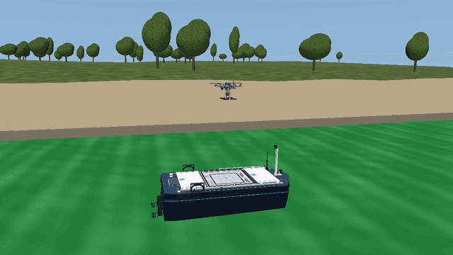

# vision-based-drone-landing-ml
Machine learning for camera-based drone landing on moving boats.

Recorded simulation flights with the frozen hybrid ML policy across island,
beach, city, gravel and rock, with varied water, waves, wind, rain and fog.
This 25-second loop matches drone height across scene changes; descent footage
is slowed for continuity. The boat model and landing criteria are unchanged.

- [Drone simulation](px4-mujoco-drone-simulation/README.md)
- [AERODOCK boat simulation](AERODOCK_MuJoCo/README.md)
- [Combined landing environment and training workflow](landing_training/README.md)
- [Tidewater integration and frozen-policy results: 3 landings, 1 safe abort](landing_training/TIDEWATER.md)

The combined environment exports review videos and recorded input/output data.
Training collection requires explicit user verification of that review bundle.

The [landing technical report](landing_training/docs/technical_report.md)
explains the shared physics, dataset design, recurrent policy and evaluation phases.
