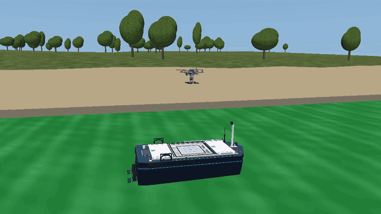
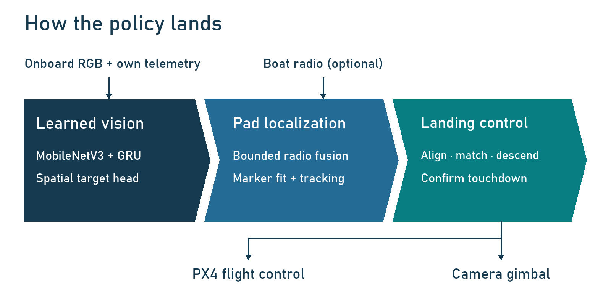
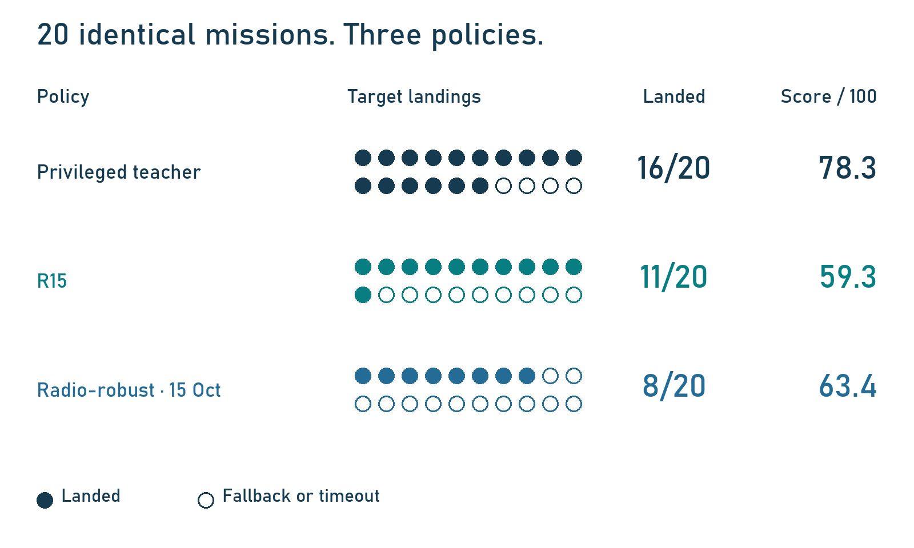

[Watch the landing in 1080p](docs/media/tidewater-landing-1080p.mp4) · [Recording details](docs/media/README.md)

# Vision-based drone landing

A drone that finds a boat through its onboard camera, matches the moving deck,
and lands under PX4 control.

**Trained only in MuJoCo.** The frozen policy also lands in Tidewater, an
environment it never saw during training. The opening flight demonstrates
that transfer without retraining.

[Training and architecture](landing_training/README.md) ·
[Tidewater game](tidewater-game/README.md) ·
[Benchmark results](benchmark/README.md)

## Beyond the training scenes

The montage tests new combinations of water appearance, rain, fog, wind and
waves. These scenarios were absent from training, and the policy was not
retrained for them.

## How it lands

Learned vision finds the boat and estimates its pose. Marker geometry and
tracking localize the landing pad. The controller matches deck motion and
descends; PX4 flies the commands.

## Measured performance

The score combines landing, acquisition and completion speed.
[See the 25 October comparison and every flight](benchmark/reports/2026-10-25/RESULTS.md).

The separate wave-gate teacher completed the full revised 20-case suite at
**99.17/100** with **20/20 strict target landings** in November 2026.
[Full-20 results](benchmark/reports/2026-11-04-teacher-four/FULL20_RESULTS.md).

The project began with a coupled boat–drone world and an action-imitation
baseline. Flight failures led to the hybrid vision-and-geometry policy;
Tidewater demonstrated visual transfer. Current work improves finding the
correct boat among decoys.

[Boat simulation](AERODOCK_MuJoCo/README.md) ·
[Drone simulation](px4-mujoco-drone-simulation/README.md) ·
[Documentation](docs/README.md) · [License](LICENSE)
