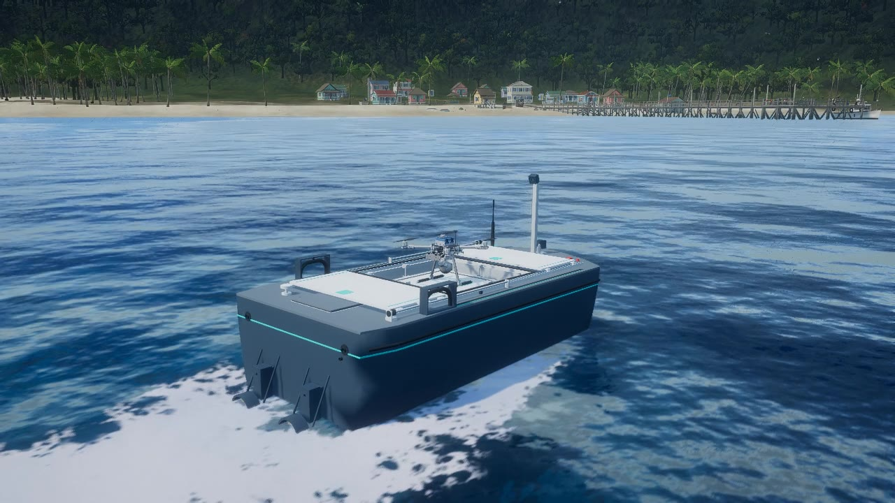

**[Project website and playable simulator](https://aerodock-b9t.pages.dev/)** · [Watch the film (45 s)](website/assets/hero.mp4) · [Earlier landing in 1080p](docs/media/tidewater-landing-1080p.mp4)

# Vision-based drone landing

A drone finds a moving boat with its camera and lands on the 60 cm pad on its
deck, in wind and waves, with other boats around. Two neural networks do the
seeing; control code and the PX4 autopilot do the flying.

Everything runs in simulation. The networks were trained only in MuJoCo and
also fly in a second, realistic simulator whose graphics they never saw.
Nothing has flown on real hardware yet.

| | |
|---|---|
| Benchmark | **18 of 20** missions landed (score 79.9 / 100) |
| Networks | Search head, about 45,000 parameters; main network, about 1.55 million |
| Inputs | One 640 × 360 camera that can turn and tilt, the drone's own sensors and, if the boat sends it, its GPS position by radio |
| Outputs | Velocity, yaw rate and camera pan/tilt at 25 Hz, flown by PX4 1.16 |
| Vehicles | Holybro X500 V2 drone and the AERODOCK boat, both modelled in FreeCAD |

## How it lands

The search head looks at every camera frame and marks the boats it sees,
telling the target apart from similar and different boats. With radio, the
drone flies to the boat's position first; without it, it climbs to about 7 m
and turns on the spot until the search head finds the target. Then the main
network estimates where the pad is and how the deck is moving, and the control
code keeps the camera on the pad and the drone above it, and brings it down.
In the last few metres the camera also measures the printed pattern on the pad
directly.

[How it works, step by step](landing_training/README.md)

## Results

Each bar is one version of the design. The first was tested on 12 flights, the
others on the same 20 MuJoCo missions: five coasts, boats up to 1.5 m/s, 4 m/s
crosswind, waves, searches from 100 m and decoy boats. A landing only counts if
the drone ends up disarmed and stable on the pad.

With the search head, the final version lands every landing, wind and search
mission. It fails two
missions with waves, where it hovers just above the pad waiting for a clean
measurement until time runs out. The teacher, which sees the simulator's
ground truth, lands all 20 and marks the ceiling.

[Benchmark, evidence and viewer](benchmark/README.md)

## A second, realistic world

The [realistic simulator](tidewater-game/README.md) is a browser game with its
own ocean, sky and boats, where you can fly the drone yourself and hand it over
to the networks. They fly there without any retraining. You can
[play it in your browser](https://aerodock-b9t.pages.dev/#play) (a computer with
Chrome or Edge and a capable graphics card). In recorded sessions
with the radio switched off, the drone found the boat and landed on the pad
from 122 m away, and from 15 m with the boat behind it.

## Repository

| Folder | Content |
|---|---|
| [`landing_training/`](landing_training/README.md) | Coupled MuJoCo world, teacher, data recording and the policy |
| [`px4-mujoco-drone-simulation/`](px4-mujoco-drone-simulation/README.md) | X500 V2 drone: CAD, MuJoCo model, PX4 link |
| [`AERODOCK_MuJoCo/`](AERODOCK_MuJoCo/README.md) | AERODOCK boat: CAD, water physics, world generator |
| [`benchmark/`](benchmark/README.md) | 20-mission benchmark, five policies, all flight evidence |
| [`tidewater-game/`](tidewater-game/README.md) | Browser game with PX4, MuJoCo and the policy running locally |
| [`training_runs/`](training_runs/training_data_generation/README.md) | Training-data generation and the search-head training code |
| [`website/`](website/README.md) | Static project site |
| [`docs/`](docs/README.md) | Media, figures and background documents |
| `artifacts/`, `old/` | Frozen experiments and the previous benchmark, kept as evidence |

The benchmark pins the simulator and policy source by path and hash, so those
folders keep their names. `python -B tools/check_layout.py` verifies the pins on
a working tree that also holds the untracked experiment files in `artifacts/`.

[License](LICENSE)
