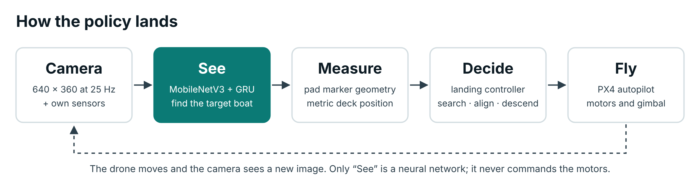
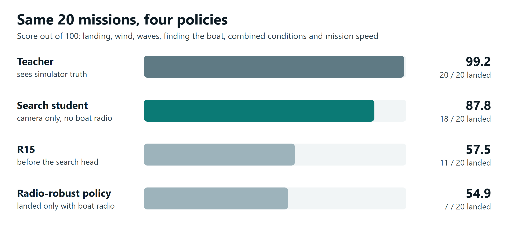

[Watch the film (45 s)](website/assets/hero.mp4) · [Earlier landing in 1080p](docs/media/tidewater-landing-1080p.mp4) · [Project website](website/index.html)

# Vision-based drone landing

A drone that finds a moving boat through its onboard camera, matches the deck
and lands on it under PX4 control.

**Trained only in MuJoCo.** The same frozen policy also lands in Tidewater, a
realistic ocean game it never saw during training.

| | |
|---|---|
| Benchmark | **18 of 20** missions landed, score 87.8 / 100 |
| Inputs | One 640 × 360 camera and the drone's own sensors. No boat position. |
| Outputs | Velocity, yaw rate and camera pan/tilt at 25 Hz, flown by PX4 1.16 |
| Vehicles | Holybro X500 V2 drone and the AERODOCK boat, both from FreeCAD |

## How it lands

A neural network finds the boat and estimates its motion. Close to the deck,
the known pad marking gives a metric position. An explicit controller searches,
aligns, matches the deck and descends; PX4 flies the commands. The network
never commands the motors.

[Training and architecture in detail](landing_training/README.md)

## Results

All policies fly the same 20 MuJoCo missions: five coasts, boat speeds up to
1.5 m/s, 4 m/s crosswind, waves, a search from 100 m and decoy boats. A landing
counts only when the drone is disarmed and stable on the pad.

The current search policy lands every mission in the landing, wind, wave and
search categories. It fails both missions that combine all conditions at once.
The teacher uses simulator truth and is the upper reference, not a deployable
policy.

[Benchmark, evidence and viewer](benchmark/README.md)

## Beyond the training scenes

New combinations of water, rain, fog, wind and waves in MuJoCo. None were in
the training data, and the policy was not retrained.

## Repository

| Folder | Content |
|---|---|
| [`landing_training/`](landing_training/README.md) | Coupled MuJoCo world, teacher, data recording and the policy |
| [`px4-mujoco-drone-simulation/`](px4-mujoco-drone-simulation/README.md) | X500 V2 drone: CAD, MuJoCo model, PX4 link |
| [`AERODOCK_MuJoCo/`](AERODOCK_MuJoCo/README.md) | AERODOCK boat: CAD, water physics, world generator |
| [`benchmark/`](benchmark/README.md) | 20-mission benchmark, four policies, all flight evidence |
| [`tidewater-game/`](tidewater-game/README.md) | Browser game with PX4, MuJoCo and the policy running locally |
| [`training_runs/`](training_runs/search_revision_20261025/README.md) | Search-head datasets and training runs |
| [`website/`](website/README.md) | Static project site |
| [`docs/`](docs/README.md) | Media, figures and background documents |
| `artifacts/`, `old/` | Frozen experiments and the previous benchmark, kept as evidence |

The benchmark pins the simulator and policy source by path and hash, so those
folders keep their names. `python -B tools/check_layout.py` verifies the pins on
a working tree that also holds the untracked experiment files in `artifacts/`.

[License](LICENSE)
