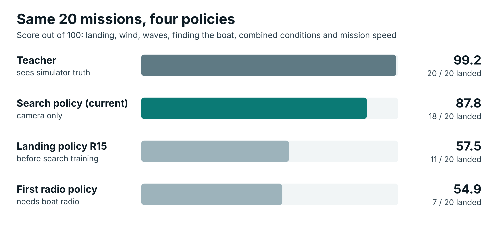

# Benchmark

Four policies fly the same 20 MuJoCo missions with PX4 in the loop.



| Policy | Score | Landed | What it is |
|---|---:|---:|---|
| Privileged teacher, wave-aware gate | 99.2 | 20 / 20 | Uses simulator truth. Upper reference, source of training labels. |
| Search policy on frozen R15 | 87.8 | 18 / 20 | Current policy. Camera and own sensors only. |
| R15 | 57.5 | 11 / 20 | Landing policy before search training. |
| Radio-robust, 15 October | 54.9 | 7 / 20 | First hybrid policy; relies on the boat radio. |

All 80 flights were valid. Exact values and every episode are in
[`benchmark.json`](benchmark.json).

## What is measured

| Category | Weight | Missions |
|---|---:|---|
| Find the target boat | 30 % | 10: near and 100 m starts, radio on/off, with and without decoy boats |
| Landing / boat speed | 20 % | 4: 0.6 and 1.5 m/s |
| Wind | 15 % | 2: 4 m/s crosswind |
| Waves | 15 % | 2: 0.15 m |
| Combined | 10 % | 2: wind, waves, 100 m search and decoys together |
| Mission speed | 10 % | Time to a successful landing |

A landing counts only when the drone is disarmed and stable on the pad. The
search policy lands everything except the two combined missions (one collision,
one fallback).

`condition_valid` means the scenario ran as specified; it is not a landing
grade. A policy's own "lock" is not a scored acquisition.

The previous benchmark is archived unchanged in `old/benchmark/`.

## Layout

```text
benchmark/
  benchmark.json          generated tracker and viewer data
  definition/
    suite.json            frozen 20-case suite
    runtime.json          pinned source, asset, and harness receipts
  policies/
    inventory.json        the three inventory policies used by the runner
    <policy>/             normalized model, policy, architecture, and weights
    student/              frozen search-student source and identity receipt
    weights/              content-addressed weights used by the four policies
  evidence/
    teacher/               20 canonical episodes
    student/               20 canonical episodes (18 strict landings)
    r15/                   20 canonical episodes
    radio/                 20 canonical episodes
  harness/                runner, scoring, tracker, digest, routes, and PX4 bridge
  viewer/index.html       static comparison viewer
  runs/                   new flights; intentionally empty
  tests/                  focused digest tests
```

Each canonical episode contains only `result.json`, `case.json`, `steps.jsonl`,
and the two diagnostic digest files. Logs, staging folders, failed candidates,
old revisions, and training data were deliberately not copied.

## Commands

Run from the repository root, where the shared simulator and source bundles are
available:

```powershell
python -B -m benchmark track
python -B -m benchmark run --name r15_20261111 --policy r15-archived-export-67a80a63
python -B -m benchmark run --name radio_20261111 --policy radio-robust-20261015-policy-bundle-44826e5a
```

`track` never starts MuJoCo, PX4, or a policy. It rebuilds `benchmark.json`
from recorded episodes. A new flight writes to `runs/` and updates the tracker;
canonical evidence is never rewritten.

The worker subprocess imports the active `benchmark` package, not the archived
`old/benchmark` tree. New flights are separate working data and are not
canonical evidence.

## Viewer

Serve the repository root and open the V2 viewer:

```powershell
python -m http.server 8000
```

Then open `http://localhost:8000/benchmark/viewer/index.html`. The viewer
fetches `../benchmark.json` relative to its own page.

## Student identity

The student policy is the canonical `fresh-search-f62c10a2` bundle. Its policy
identity receipt (`policies/student/identity.json`) is carried from the
canonical bundle unchanged; moving the package changed path resolution, not the
policy identity or its checkpoint. The V2 adapter still declares the same
zero-radio input allowlist and uses the same checkpoint and frozen R15 base.

## Tests

```powershell
python -m unittest benchmark.tests.test_rollout_digest -v
```

The digest test is independent of the simulator. The benchmark requires the
same Windows/PX4, MuJoCo, PyTorch, and source-bundle prerequisites as the
original runner.
