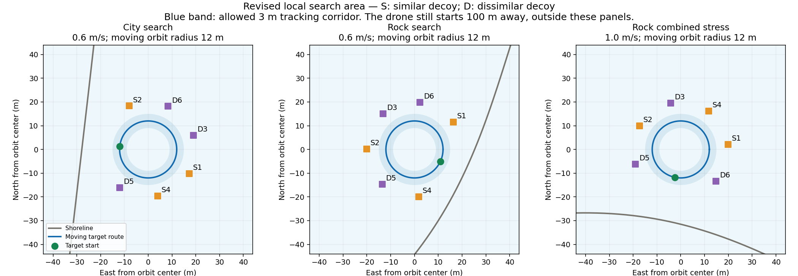

# Bounded moving-target search revision

The real target previously travelled away from the stationary decoy cluster while
the teacher inspected decoys. These three replacements keep it moving on a fixed,
water-safe orbit beside the decoys. The route does not read the drone's position,
camera, actions, teacher decisions or target-confirmation state.

The prepared [suite](suite.json) has 20 cases. Exactly these three receive new IDs:

- `acquisition-far-visual-traffic-city-r0-bounded-v1`
- `acquisition-far-visual-traffic-rock-r1-bounded-v1`
- `combined-stress-visual-traffic-rock-r0-bounded-v1`

The other seventeen case definitions are unchanged. Historical v3 cases, source
pins and results remain in their original files. This revision uses separate
receipts and result directories; old scores cannot count as v4 results. Because
only these requested cases change, comparisons with their old radio-on variants
no longer isolate the effect of radio alone. Compare actors on the same new case.



## Measured camera envelope

[visibility_calibration.json](visibility_calibration.json) contains 2,100 actual
640x360 MuJoCo target-segmentation measurements: ranges 10–180 m in 5 m steps,
twelve hull headings, and five roll/pitch poses up to ±8 degrees. The actual
reviewed CAD, onboard optics, prepared deck and teacher detection predicate were
used, at 6 m deck clearance and a 6 degree search-camera tilt.

- Every sampled orientation passed the **24 visible pixels / 8 pixel extent**
  detection test from **15 through 65 m**. Some failed at **70 m**.
- The design uses **60 m** as its conservative maximum local detection range.
- At 25 m the weakest sampled view had a 24 pixel extent; at 20 m it had
  31 pixels of extent. Identification still requires the original range, image
  evidence, sustained observation and visible-marker rules; detection does not
  declare the target identified.
- Below 15 m, holding the search camera at 6 degrees can put the boat outside
  its field of view. Existing close-inspection gimbal aiming must look down.
  No minimum drone-to-target distance is imposed: the drone must still land.

These are finite rendered samples with the target in view, not a promise through
occlusion, camera misalignment or arbitrary untested sensor attitudes. The 100 m
initial search starts are retained and can still contain unresolved boats.

## Route and spacing

| Parameter | Value |
|---|---:|
| Nominal moving orbit radius | 12 m |
| Maximum allowed radial tracking error | 3 m |
| Six static decoys' radius about orbit center | 20 m |
| Decoy angles relative to the outward shore normal | −120, −72, −24, 24, 72, 120 degrees |
| Nominal target-to-nearest-decoy distance | 8.0–17.44 m |
| Enforced target-to-nearest-decoy bounds | 5–20 m |
| Camera-calibrated local inspection standoff | Within 24 m of any decoy |
| Worst-case local target range, including navigation tolerance and pad offset | 59.03 m |
| Target speeds, city / rock / combined | 0.6 / 0.6 / 1.0 m/s |
| Mission budget / acquisition scoring deadline | 240 / 120 simulated seconds |

The orbit extends seaward and its direction matches the original heading. The
rock search's whole boat/drone/home start arrangement is translated 3 m seaward
to make the tracking corridor water-safe; relative target range remains 100 m.
The city and combined starts need no translation. Route length exceeds the entire mission's travel
distance and includes complete repeated laps, so the boat does not stop at an
endpoint. All six authored distractors remain: three similar and three dissimilar.
They are repositioned safely outside the orbit, with route, shore and mutual
spacing checks. Initial target range, camera visibility contract, radio absence,
weather, waves, boat CAD, forces, speed tolerances and landing scorer remain.

A drone within 24 m of any decoy is at most
`24 + 20 + 12 + 3 + pad_offset = 59.03 m` from the target, below the measured
60 m design limit. This is a world-fixed spatial opportunity, not a target path
that chases the student or guarantees success for any student behavior.

The original navigator's 9 m minimum look-ahead on this compact orbit made it
overspeed: the first 100 s physical check averaged 1.286 m/s for a requested
1 m/s, and failed the unchanged speed tolerance. A shorter look-ahead did not
solve tracking, so it was discarded. The new cases keep the **original 9 m / 5 s
look-ahead**, gains and thrust limits, and enable extra turn-thrust boost only
below **0.25 m/s**. At normal speed the existing PI controller can therefore slow
the boat instead of being overridden by a permanent turn-thrust floor. The orbit
is aligned once, before the first scored sample, to the target's actual
mission-start position; this removes pre-flight drift without moving the boat or
changing the relative route/decoy geometry. The exact
pinned navigation expressions are checked before adapting them; mismatched source
fails. The original overspeed check, the rejected short-look-ahead trial and the
initial too-tight 2 m corridor remain under `audits/` with source snapshots.

During real trials a separate environment monitor checks the actual boat's path,
shore clearance and target/decoy spacing at 10 Hz. Breaches invalidate the
scenario and preserve the evidence; the boat is never teleported or clamped into
the envelope. These checks do not change actor observations or grant landing
success. Original actual-speed validity checks still apply.

## Commands

Run from the repository root. This is the entry point for the revised cases;
the original `python -m benchmark` command remains the frozen v3 suite.

Prepare/verify the revision, without launching a policy:

```powershell
python -B -m benchmark.revisions.bounded_search_20261026 prepare
```

Run all three revised cases with the completed new student:

```powershell
python -B -m benchmark.revisions.bounded_search_20261026 run --policy fresh-search-f62c10a2 --device cuda --name bounded_student_20261026
```

Run the frozen benchmark teacher and R15 on those same three cases:

```powershell
python -B -m benchmark.revisions.bounded_search_20261026 run --policy privileged-teacher-platform-aligned-7ac0a6ff r15-archived-export-67a80a63 --device cuda --name bounded_reference_20261026
```

Each command defaults to the three replacements, sequentially. `--all-cases`
selects the full 20-case revision; `--case` selects exact prepared case IDs.
Use a new run name each time; existing evidence is never overwritten.

The fresh student adapter constructs its strict onboard-input allowlist and
records the actual SearchRuntime/checkpoint identity. No boat beacon, target
coordinates or oracle annotations are passed to it. The common mission reserve
guard remains intact: its separate compatibility issue with the new student's
approach diagnostics is **not fixed by this scenario revision**.

## Failure review digest

Every completed trial writes `diagnostic_digest.txt` and
`diagnostic_digest.json` beside its `result.json`. The digest is produced from
the recorded 25 Hz `steps.jsonl`, not from RGB, and does not launch MuJoCo, PX4
or a policy. It contains an outcome summary, scoring-only target geometry,
event-driven keyframes and adaptive heartbeat rows. This is the intended first
read when reviewing a failure; use the JSON for exact frames.

Backfill older recordings without a new flight:

```powershell
python -B -m benchmark.rollout_digest benchmark/revisions/bounded_search_20261026/runs/<run> --overwrite
```

The text's `fov_r` is a geometric projection of the true pad centre through the
logged drone attitude and gimbal. It is not pixel visibility: occlusion and
decoy pixels are not present in these traces. Target position is post-flight
scoring truth and is never policy input. The deck frame uses the recorded pad
rotation when available; benchmark rows use pad motion heading as a documented
proxy, so lateral values near turns are approximate.

## Validation and limits

- [Final geometry audit](audits/geometry_v4/audit.json): actual scene rendering
  around complete orbits and six decoy inspection anchors; includes visible
  pixel counts, extent, terrain exclusions and occlusion checks.
- [Final combined-motion audit](audits/motion_combined_v4/audit.json): native
  boat navigation, forces, wind and waves, without a policy/PX4 flight. Its
  recorded duration and actual speed/envelope checks are authoritative.
- [Final rock-motion audit](audits/motion_rock_v4/audit.json): 180 simulated
  seconds, including a complete orbit; mean speed 0.573 m/s for the 0.6 m/s
  request, zero samples outside the original tolerance, maximum radial error
  1.617 m within the 3 m corridor.
- `python -B -m unittest discover -s benchmark/tests -p 'test*.py' -v` checks the
  original contract/scorer and the new geometry/versioning invariants.

These checks establish scenario feasibility, not a teacher or student landing
rate. No teacher or learned-policy scored flight is launched by preparation or
audit. Full landing results require the explicit run commands above.

## Approved two-worker batch

The approved 26 October batch is
[bounded_teacher3_student20_20261026_v1](../../runs/bounded_teacher3_student20_20261026_v1/run.json).
It runs the frozen benchmark teacher on the three replacements and the completed
`fresh-search-f62c10a2` student on all twenty revision cases, with exactly two
isolated workers. Each trial retains the original 240 simulated second budget.
The unchanged common mission reserve guard can end a mission earlier.

The independent hidden Windows process keeps the computer awake while the batch
runs. [Progress](../../runs/bounded_teacher3_student20_20261026_v1/progress.json),
[results](../../runs/bounded_teacher3_student20_20261026_v1/RESULTS.md) and
[machine-readable summary](../../runs/bounded_teacher3_student20_20261026_v1/summary.json)
update automatically after each flight. Each flight also records the actual
640x360 onboard RGB frames to `onboard.mp4`, with a checksum and frame receipt;
recording requests no extra render and does not alter actor input. Infrastructure
or scenario-envelope failures stop new dispatch and retain evidence. Actual
policy failures remain scored outcomes. Existing trials are never overwritten.

The teacher's new coverage is three cases, not a full-suite teacher rerun.
Historical scores are retained separately and are never counted as new v4
flights. The student's strict zero-radio adapter is used even in cases whose
historical name includes radio. Its frozen base remains R15; only the finished
fresh search head is evaluated. No training or weight updates occur.
