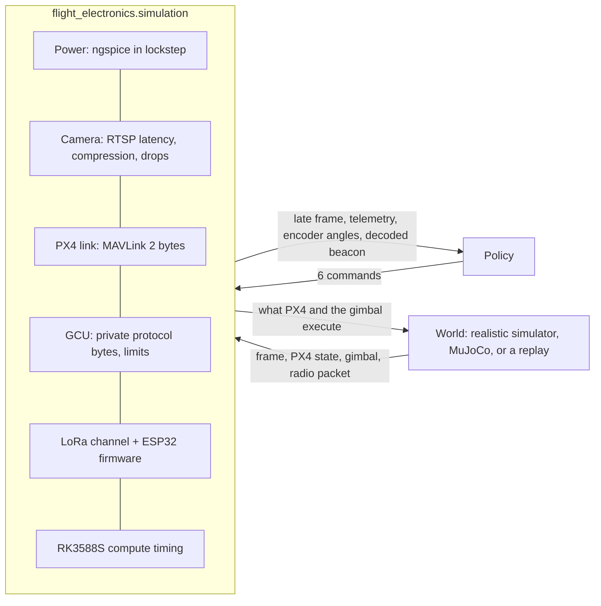
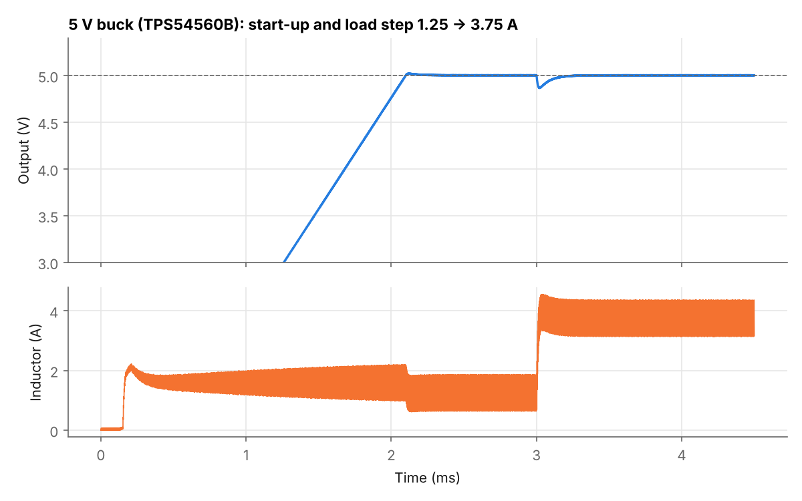
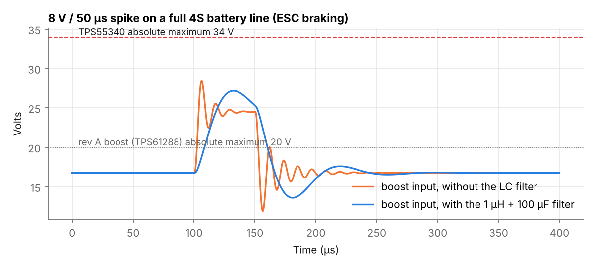

# Flight electronics

The electronics that would carry the landing policy onto the real drone, and a
simulation of them that the realistic simulator can fly through.

**Nothing here has been built or flown.** The parts are chosen, the circuit is
drawn and simulated, the code compiles and passes its tests, and the landing
policy runs through the simulated hardware. Every value comes from a data sheet,
from the existing drone model, or is marked as an assumption.

| | |
|---|---|
| Companion computer | **Orange Pi 5** (Rockchip RK3588S, 46 g), replaces the Khadas Edge2 |
| Carrier board | **FE-1**, 100 × 62 mm, 2 layers: battery protection, 5 V / 5 A for the computer, 17 V for the camera, the radio and every connector |
| Radio | XIAO ESP32S3 + Wio-SX1262, LoRa 868 MHz, firmware in C++ |
| Simulation | ngspice circuit models, the real firmware and protocol code, a timing model of the RK3588S |
| Realistic simulator | `tidewater-game/hardware_runner` puts this hardware between the game and the policy |

## The system


The drone, the camera and the radio module stay as bought. Three things are new:

- **Orange Pi 5 instead of the Khadas Edge2.** Same RK3588S chip, so the same
  speed. The camera sends its video only over Ethernet; the Orange Pi 5 has an
  Ethernet port, the Edge2 does not. It also has three free UARTs on its pin
  header and a plain 5 V input, so no USB adapters and no USB-PD supply are needed.
- **A 17 V supply for the camera.** The D-80Pro needs **14 to 53 V**. A 4S
  Li-ion pack is 16.8 V full and falls below 14 V under load long before it is
  empty (see [the flight simulation](#what-the-simulations-show)).
- **One carrier board** for the protection, both regulators, the radio module and
  all connectors, instead of loose modules and cables.

| Link | Wiring | Protocol |
|---|---|---|
| Camera video | GCU Ethernet → Orange Pi 5 RJ45 | RTSP sub-stream 1920 × 1080, decoded in hardware, scaled to 640 × 360 |
| Gimbal | Orange Pi 5 UART4 ↔ GCU (J4) | ALLXF GCU private protocol V2.0.6, 50 Hz, head-lock rate control |
| Autopilot | Orange Pi 5 UART1 ↔ Pixhawk 6C TELEM2 (J5) | MAVLink 2, 921 600 baud, velocity + yaw-rate setpoints |
| Boat radio | Orange Pi 5 UART3 ↔ XIAO ESP32S3 | COBS frames with CRC-16, 921 600 baud |
| Boat | SX1262 ↔ boat transmitter | LoRa SF7, 125 kHz, 32-byte beacon, 72 ms on air |

## Circuit


[Schematic as PDF](circuit/kicad/fe_carrier_schematic.pdf) · [BOM](circuit/kicad/fe_carrier_bom.csv) ·
KiCad 9 project: `circuit/kicad/fe_carrier.kicad_pro`

| Block | Parts | Why |
|---|---|---|
| Input | XT30, 10 A fuse, AOD4185 P-MOSFET, SMBJ16A, 100 µF | Reverse-polarity protection without a diode drop; clamp for spikes |
| 5 V / 5 A | TPS54560B, 6.8 µH, B560C, 3 × 47 µF | Component values are TI's own 5 V / 5 A design example |
| 17 V | TPS61288, 4.7 µH, 4 × 22 µF, 1 µH input filter | Above a full pack (16.8 V), 3 V above the camera minimum, below the chip's 18 V limit |
| Radio | XIAO ESP32S3 + Wio-SX1262 on castellated pads, SS14 | The diode stops the board feeding a USB host when the XIAO is plugged in |
| Connectors | 2 × 13 header to the Orange Pi 5, JST-GH to TELEM2 and the GCU, XT30 to the camera | 100 Ω series resistors on every UART line |

The pin header follows the Orange Pi 5 manual (section 3.16): 5 V on pins 2 and
4, UART1 on pins 3/5, UART4 on 16/18, UART3 on 19/21, all 3.3 V logic.

## PCB

| Top | Bottom |
|---|---|
|  |  |

Battery input on the left, the 5 V buck in the top half, the 17 V boost in the
bottom half, the radio in the middle and the Orange Pi 5 header on the right
edge. The board is the Orange Pi 5's size so the two can be stacked on standoffs.
Both copper layers carry a ground plane.

The schematic has no ERC errors and the PCB matches it. A small grid router in
`circuit/kicad/router.py` (A* on both layers, power nets first and 0.8 mm wide,
design-rule clearances built in) laid **62 of the 73 connections**; GND is the
plane on both layers, stitched with vias. **Still to route by hand** before
ordering: the pins of the TPS61288 (U2, 0.5 mm pitch: SW, BST, EN, COMP) and the
fuse-to-MOSFET link (F1 to Q1). DRC reports one clearance error, at U2 pin 6, from
the router's 0.2 mm grid. The XT30 connectors, the TPS61288 and the XIAO stack
have no KiCad 3D models, so simple boxes stand in for them in the renders.

## Simulation

The simulation is a library that knows nothing about a particular simulator. A
world hands it, every 40 ms, what really exists: the rendered camera frame, the
autopilot's estimate, the gimbal angles, a boat radio packet. It returns what
the companion computer would really see, and what the autopilot and the gimbal
really execute.



| Part | How it is simulated |
|---|---|
| Electrical | ngspice (the same SPICE engine KiCad uses). Cycle-by-cycle models of both converters; an averaged model of the whole aircraft supply solved in lockstep with the flight, every 40 ms. Brown-outs follow from the computed voltages. |
| ESP32 firmware | The firmware sources, compiled for the PC. A behavioral SX1262 answers the same SPI commands as the chip. |
| MAVLink, GCU | The companion code produces and parses the real bytes. The MAVLink encoder matches pymavlink byte for byte; the GCU code reproduces the example packets in the protocol document, CRC included. |
| Camera | 120 ms ± 15 ms network-camera latency (published figures for H.264 RTSP: 100–200 ms), JPEG-like compression, rare drops, 25 s reboot after a brown-out (assumption). |
| Compute | RK3588S timing model. The network runs on the NPU (from published RK3588 measurements of a network with the same amount of computation); the control code's times were measured here and scaled to one Cortex-A76 core. To be replaced by measurements on the board. |

### What the simulations show

| Question | Result |
|---|---|
| Is the 5 V supply clean? | 5.00 V, about 9 mV ripple; a 1.25 → 3.75 A step dips 136 mV (2.7 %). TI's targets: 25 mV and 4 %. |
| Does the camera supply hold? | 17.0 V from a 12 V (empty) pack; a 1 → 2.5 A step dips about 0.3 V. |
| Camera straight on the battery? | **It switches off after 13.5 minutes with 61 % charge left.** On the 17 V boost it stays on for the whole flight. |
| Battery-line spike, 8 V for 50 µs | **Fails.** The boost input reaches about 27 V; the TPS61288 is rated 20 V absolute maximum. See [open points](#open-points). |
| Does 25 Hz fit on the RK3588S? | Yes with the C++ marker kernel and the network on the NPU: about 18 ms while searching, 22 ms while tracking the pad, 47 ms for the first registration of the pad (one tick late). In pure Python the first registration takes about 275 ms. |


| 5 V buck | 17 V boost |
|---|---|
|  |  |

| Input spike | Decision latency |
|---|---|
|  |  |

All numbers: [`media/simulation_results.json`](media/simulation_results.json).

## Run it

Python 3.10+ with numpy; ngspice as a shared library (`apt install libngspice0`,
or `ngspice.dll` from the ngspice Windows release); a C++ compiler for the
firmware (on Windows the prebuilt `firmware/prebuilt/fe_radio_bridge.dll` is
used when no compiler is found).

```powershell
python -m unittest flight_electronics.tests -v          # protocols, firmware, circuits, board
python -m flight_electronics.firmware.build_host        # firmware for the PC + its unit tests
python -m flight_electronics.tools.make_figures         # all simulations and figures
python3.12 -m flight_electronics.circuit.kicad.generate # schematic, PCB, ERC/DRC, renders (KiCad 9)
```

Fly the realistic simulator through the simulated hardware (Windows, the same
setup as `benchmark.harness.tidewater_run`):

```powershell
python -B tidewater-game/hardware_runner/run.py run --name hw_try --case <case id>
python -B tidewater-game/hardware_runner/run.py run --name hw_late --case <case id> --state-of-charge 0.3 --variant camera_on_battery
python -B tidewater-game/hardware_runner/run.py smoke    # no MuJoCo/PX4: the policy and the byte paths only
```

Every episode gets a `hardware_summary.json` next to its `result.json`:
latency, late decisions, image age, battery and camera voltages, brown-outs,
radio packets. The adapter in `tidewater-game/hardware_runner/adapter.py` is the
only code that knows both sides.

The ESP32 firmware for the real board builds with ESP-IDF:
`cd firmware/esp32_radio_bridge/platform/esp32 && idf.py set-target esp32s3 build flash`.
It has not been compiled for the ESP32 in this repository's environment.

## Layout

| Path | Contents |
|---|---|
| `hardware/design.py` | Every value, its source or its assumption |
| `hardware/board.py` | Every part, footprint and connection of the carrier board |
| `circuit/kicad/` | Generated KiCad 9 project, BOM, ERC/DRC reports, the generator |
| `firmware/esp32_radio_bridge/` | Radio bridge firmware: SX1262 driver, protocol, application, ESP-IDF entry, PC build |
| `companion/` | Orange Pi 5 code: camera pipeline, MAVLink, GCU protocol, radio link, timing |
| `simulation/` | ngspice binding and circuits, device models, `hil.py` (the hardware simulation) |
| `tools/` | Figures and the system diagram |
| `tests/` | Unit tests |

## Open points

1. **Boost input protection.** The TPS61288 is rated 18 V operating and 20 V
   absolute maximum, only 1.2 V and 3.2 V above a full pack. A spike from ESC
   braking can exceed that, and the 1 µH filter does not stop a 50 µs spike. For
   revision B, use a 60 V boost controller (for example TI LM5122 with external
   MOSFETs) or put a surge stopper in front of the boost. Measure the real spikes
   on the drone's power bus first.
2. **Finish routing** around U2 and F1/Q1 in KiCad, then repeat DRC.
3. **Measure on the board**: network on the NPU (RKNN, FP16) and the control
   code with the C++ marker kernel, then replace the timing model's numbers.
4. **Check on the bench**: the GCU control-port pinout and logic level, the sign
   of the gimbal yaw, the camera's real latency on the sub-stream, the Orange Pi
   5 power draw.
5. The camera latency (120 ms) was never part of the policy's training or
   benchmark, which assume a fresh frame. Run the benchmark cases through the
   hardware runner to see what it costs.

## Sources

- [Orange Pi 5 user manual](https://cdn.shopify.com/s/files/1/0252/6615/9704/files/OrangePi_5_RK3588S_User_Manual_v0.7.pdf): power, 26-pin header, weight
- [ALLXF D-80Pro](https://allxf.com/product/d-80pro-40x-4k-spherical-gimbal-camera/): specification sheet, user manual, GCU private protocol
- [TI TPS54560B](https://www.ti.com/lit/ds/symlink/tps54560b.pdf), [TI TPS61288](https://www.ti.com/lit/ds/symlink/tps61288.pdf)
- [Seeed XIAO ESP32S3 + Wio-SX1262](https://wiki.seeedstudio.com/wio_sx1262_with_xiao_esp32s3_kit/), Semtech SX1261/2 data sheet
- [rk-bench RK3588 NPU measurements](https://github.com/anguoyang/rk-bench), [ncnn on small boards](https://github.com/nihui/ncnn-small-board)
- Drone, battery and motor data: [`px4-mujoco-drone-simulation`](../px4-mujoco-drone-simulation/README.md)
