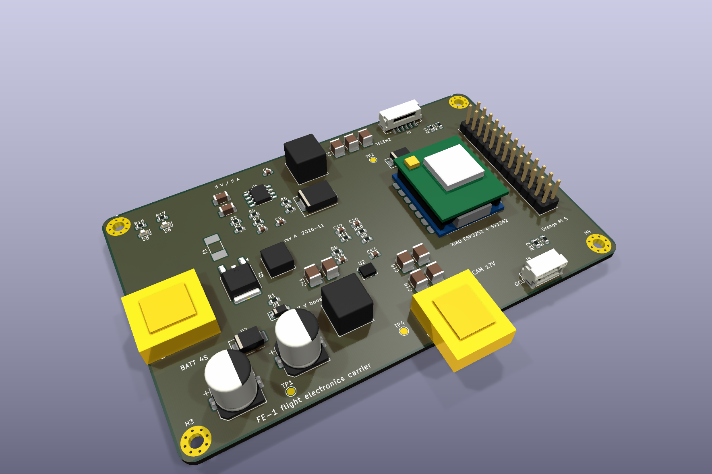

# Flight electronics

The electronics that would carry the landing policy onto the real drone, and a
simulation of them that the realistic simulator can fly through.

**Nothing here has been built or flown.** The parts are chosen, the circuit is
drawn and simulated, the code compiles and passes its tests, and the landing
policy runs through the simulated hardware. Every value comes from a data sheet,
from the existing drone model, or is marked as an assumption.

| | |
|---|---|
| Companion computer | **Orange Pi 5** (Rockchip RK3588S, 46 g), replaces the Khadas Edge2 |
| Carrier board | **FE-1 rev B**, 100 × 62 mm, 2 layers, fully routed: battery protection, 5 V / 5 A for the computer, 17 V for the camera, the radio and every connector |
| Case | 3D-printed (PETG) box with a screwed lid and vents, holds the Orange Pi 5 (with heatsink) and the carrier stacked, clamps to the X500's payload rails |
| Radio | XIAO ESP32S3 + Wio-SX1262, LoRa 868 MHz, firmware in C++ |
| Simulation | ngspice circuit models, the real firmware and protocol code, a timing model of the RK3588S |
| Realistic simulator | `tidewater-game/hardware_runner` puts this hardware between the game and the policy |

## The system

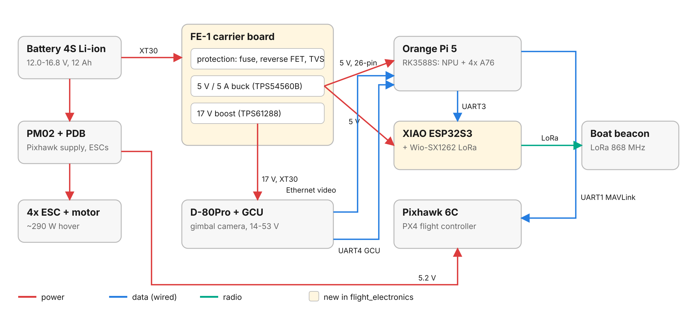

The drone, the camera and the radio module stay as bought. Three things are new:

- **Orange Pi 5 instead of the Khadas Edge2.** Same RK3588S chip, so the same
  speed. The camera sends its video only over Ethernet; the Orange Pi 5 has an
  Ethernet port, the Edge2 does not. It also has three free UARTs on its pin
  header and a plain 5 V input, so no USB adapters and no USB-PD supply are needed.
- **A 17 V supply for the camera.** The D-80Pro needs **14 to 53 V**. A 4S
  Li-ion pack is 16.8 V full and falls below 14 V under load long before it is
  empty (see [the flight simulation](#what-the-simulations-show)).
- **One carrier board** for the protection, both regulators, the radio module and
  all connectors, instead of loose modules and cables.

| Link | Wiring | Protocol |
|---|---|---|
| Camera video | GCU Ethernet → Orange Pi 5 RJ45 | RTSP sub-stream 1920 × 1080, decoded in hardware, scaled to 640 × 360 |
| Gimbal | Orange Pi 5 UART4 ↔ GCU (J4) | ALLXF GCU private protocol V2.0.6, 50 Hz, head-lock rate control |
| Autopilot | Orange Pi 5 UART1 ↔ Pixhawk 6C TELEM2 (J5) | MAVLink 2, 921 600 baud, velocity + yaw-rate setpoints |
| Boat radio | Orange Pi 5 UART3 ↔ XIAO ESP32S3 | COBS frames with CRC-16, 921 600 baud |
| Boat | SX1262 ↔ boat transmitter | LoRa SF7, 125 kHz, 32-byte beacon, 72 ms on air |

## Circuit

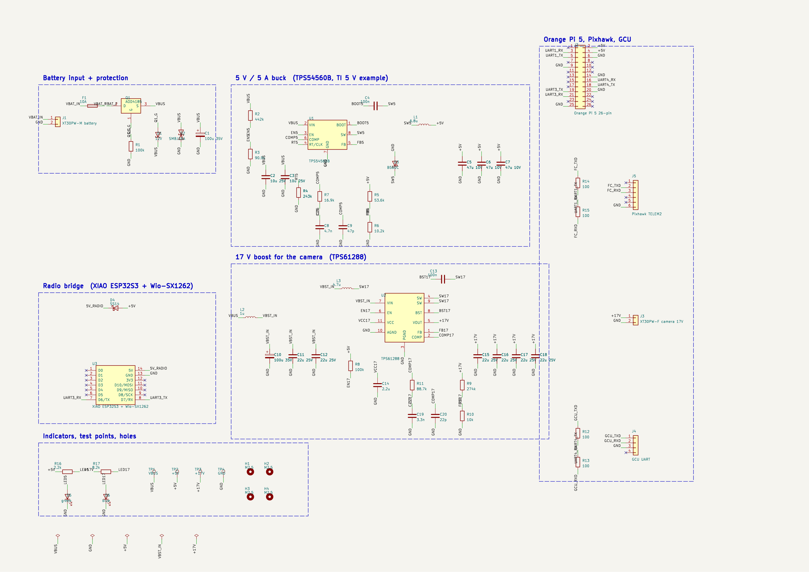

[Schematic as PDF](circuit/kicad/fe_carrier_schematic.pdf) · [BOM](circuit/kicad/fe_carrier_bom.csv) ·
KiCad 9 project: `circuit/kicad/fe_carrier.kicad_pro`

| Block | Parts | Why |
|---|---|---|
| Input | XT30, 10 A fuse, AOD4185 P-MOSFET, SMBJ16A, 100 µF | Reverse-polarity protection without a diode drop; clamp for spikes |
| 5 V / 5 A | TPS54560B, 6.8 µH, B560C, 3 × 47 µF | Component values are TI's own 5 V / 5 A design example |
| 17 V | TPS55340, 6.8 µH, B560C, 4 × 22 µF, 1 µH + 100 µF input filter | Above a full pack (16.8 V), 3 V above the camera minimum; the chip takes 32 V (34 V absolute), so battery-line spikes do not reach its limit |
| Radio | XIAO ESP32S3 + Wio-SX1262 on castellated pads, SS14 | The diode stops the board feeding a USB host when the XIAO is plugged in |
| Connectors | 2 × 13 header (ribbon cable to the Orange Pi 5), JST-GH to TELEM2 and the GCU, XT30 to the camera | 100 Ω series resistors on every UART line |

The pin header follows the Orange Pi 5 manual (section 3.16): 5 V on pins 2 and
4, UART1 on pins 3/5, UART4 on 16/18, UART3 on 19/21, all 3.3 V logic.

## PCB

| Top | Bottom |
|---|---|
| 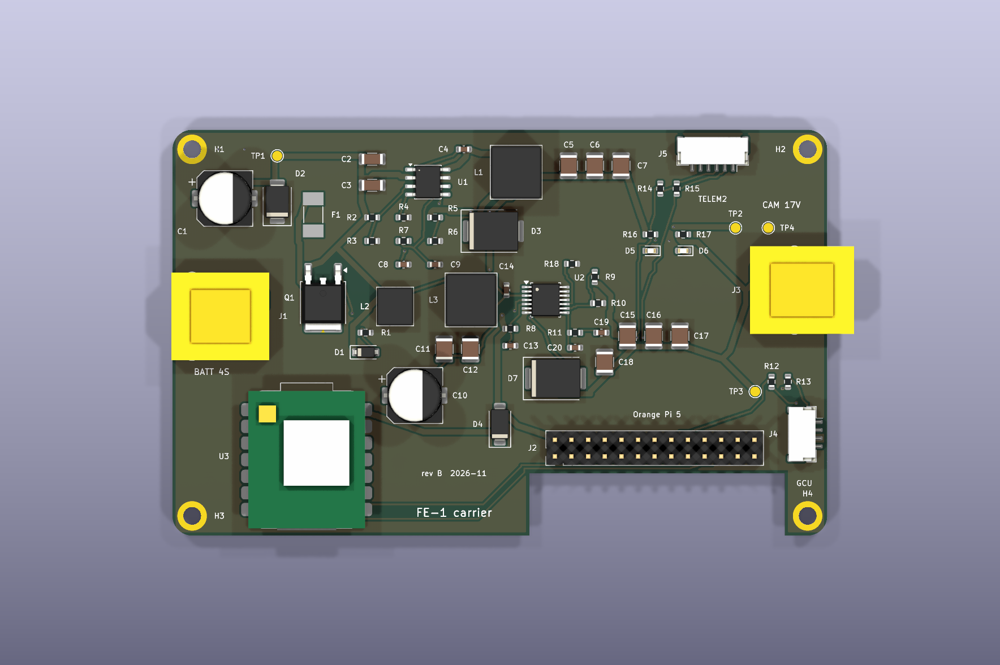 | 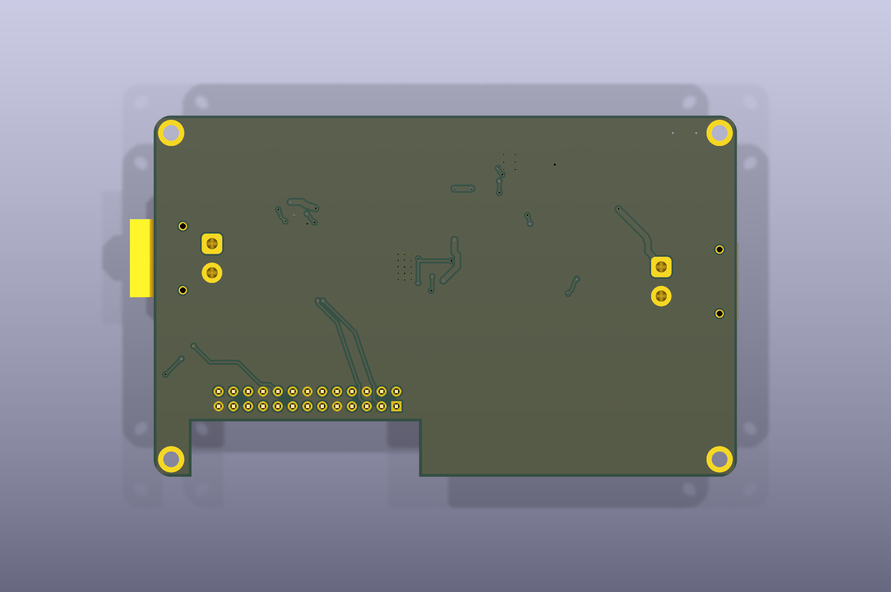 |

Battery input on the left, the 5 V buck along the top, the 17 V boost in the
middle, the radio bottom left, the GCU and TELEM2 connectors and the camera XT30
on the right. The board has the Orange Pi 5's outline and hole pattern, with a
notch at the bottom edge: the Orange Pi sits underneath, turned by 180°, so that
its 26-pin header lies under the notch and a short ribbon cable reaches the
carrier's header J2.

- **Routed completely.** No DRC errors and no unconnected pads; the PCB matches
  the schematic exactly, and the schematic has no ERC errors. The two DRC
  warnings say only that the XT30 footprints differ from the library copy: their
  silkscreen was trimmed where it hung over the board edge.
- **Router.** `circuit/kicad/router.py` is a small grid router written for this
  board (A* on both layers, 0.1 mm grid, the design-rule clearances built in,
  rip-up and narrower retries). Every bend costs extra, and each found path is
  pulled tight into straight runs and 45° pieces, so tracks are few long
  straight segments (about 250 in all, where an unsmoothed grid route needs over
  1,300). The boost's input net is routed first, then its sensitive nets (soft
  start, frequency, feedback, compensation), short.
- **Power tracks 1.5 mm wide.** Battery, 5 V, 17 V, both switch nodes and the
  boost input run 1.5 mm wide and only neck down to 0.3 mm for the last
  fraction of a millimetre onto the TPS55340's fine-pitch pins. (Before, the
  boost input and its switch node ran 0.3 mm wide over their whole length, far
  too narrow for about 3 A.) The decoupling capacitors next to both regulators
  get their ground via first, right at the pad.
- **Ground.** Both layers carry a ground plane, stitched with vias; every plane
  island is either connected or removed.
- **Silkscreen.** Every reference and label is placed automatically where it
  touches no pad, no other text, no courtyard and stays inside the board.
- The XT30s and the XIAO stack have no KiCad 3D models, so boxes stand in for
  them in the KiCad renders; the case renders and the 3D viewer use detailed
  models of them (`mechanical/connectors.py`, `mechanical/frame.py`).

## Case

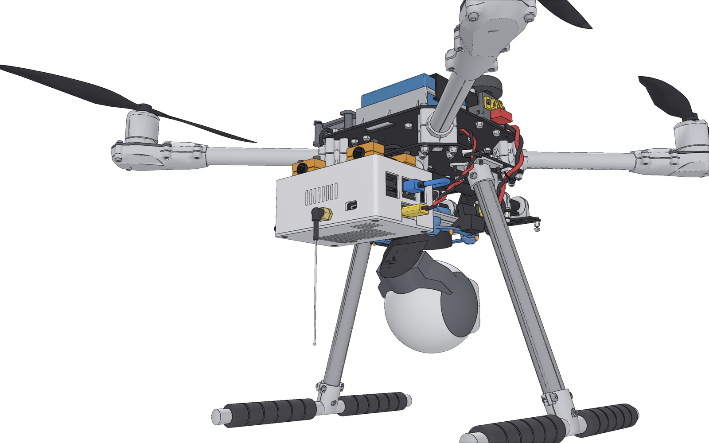

| Exploded | Lid off |
|---|---|
| 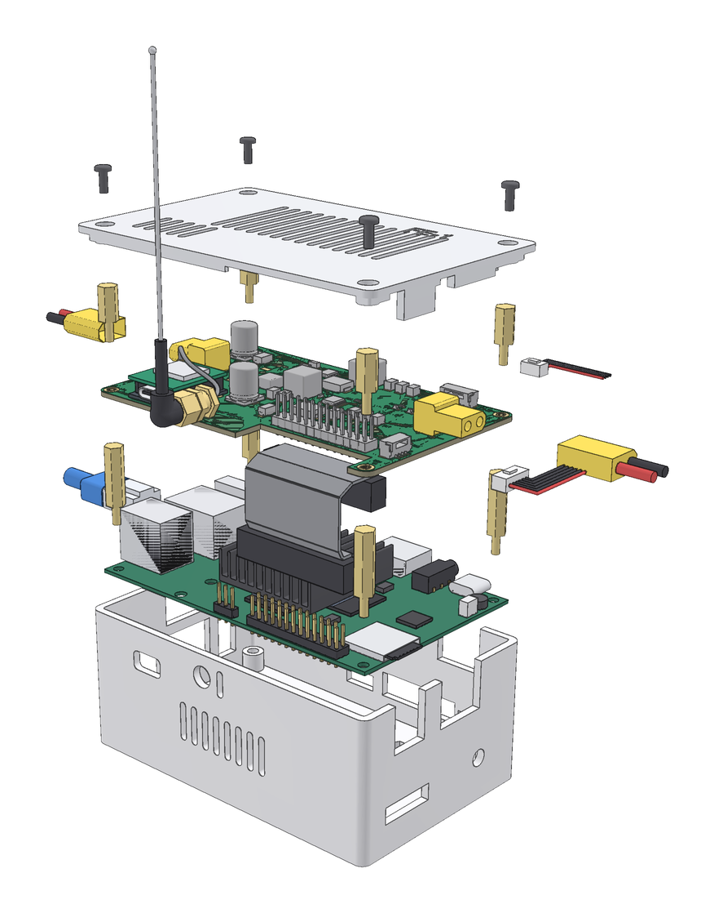 | 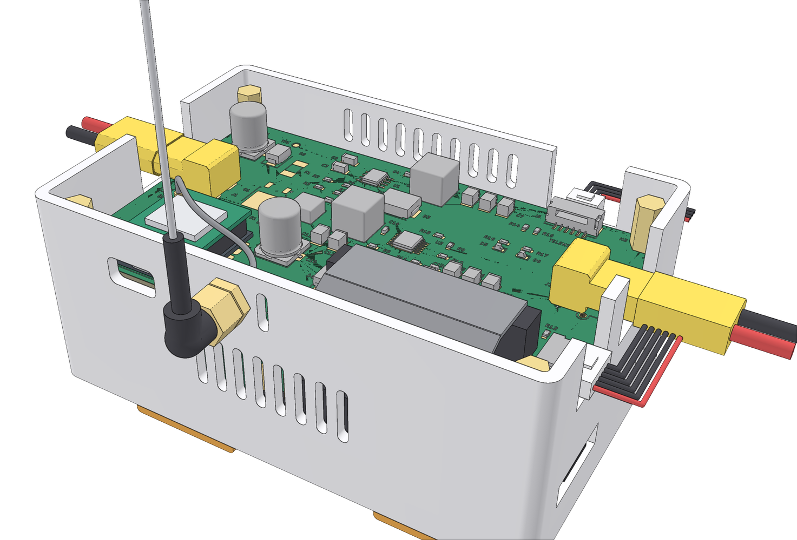 |

The build without the printed parts (frame, lid, rail clamps and their screws):

| Assembled | Exploded |
|---|---|
| 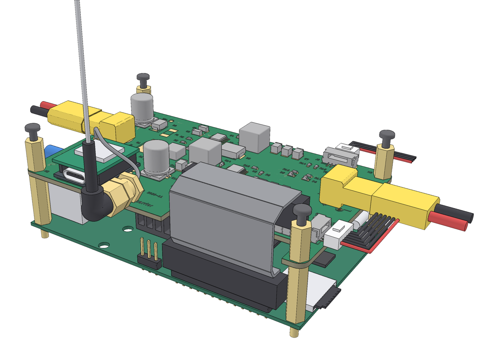 | 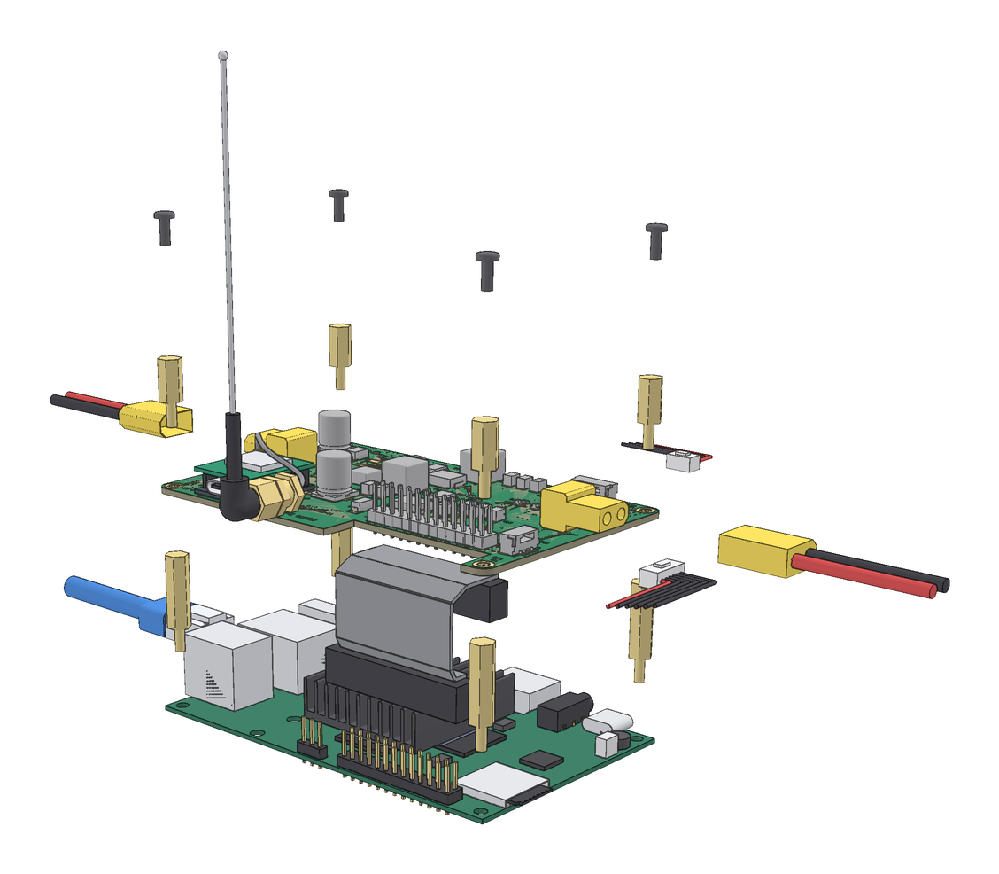 |

A printed box (106 × 68 × 46 mm; 67 g frame and 17 g lid in PETG) holds the
stack: the Orange Pi 5 on four bosses with heat-set inserts, the carrier 18 mm
above it on M2.5 standoffs, and a lid on 10 mm standoffs above the carrier. The
model is in `mechanical/frame.py` (CadQuery); print files are in `mechanical/out/`.

- **Orange Pi 5 model.** The board outline, holes and connector positions come
  from a supplied STEP model (`mechanical/models/orange_pi_5.step`). Its ports
  are boxes there; `mechanical/connectors.py` replaces them with detailed models
  in the same places (RJ45 with contacts and LEDs, stacked and vertical USB-A,
  USB-C, HDMI, audio jack, microSD with a card, pin headers).
- **Cooling.** A 35 × 35 × 10 mm aluminium heatsink with a 0.5 mm thermal pad
  sits on the RK3588S and both RAM chips, 6.5 mm below the carrier. Its fins
  run across the case, in line with vent slots in both long walls; the base
  (the top side in flight) and the lid have vents too.
- **Lid.** Four M2.5 × 6 screws into the upper standoffs. A lip locates it, and
  tongues close the connector notches down to 1 mm above each plug. It leaves
  1.5 mm above the ribbon cable, which folds over the carrier's header J2
  through the notch to the Orange Pi's header.
- **Openings** for every connector that must be reached: Ethernet (the camera),
  USB, USB-C power, HDMI, audio, the microSD card and the power key on the
  Orange Pi side; the two XT30s, both JST-GH sockets and the XIAO's USB-C on the
  carrier side, and an SMA bulkhead for the LoRa antenna with a U.FL pigtail.
- **Antenna.** An 868 MHz quarter-wave whip (86 mm) on a right-angle SMA plug
  points straight down in flight, vertical like the boat's antenna. Its tip is
  65 mm above the bottom of the landing skids and clear of the propellers, the
  legs and the camera.
- **Checked in CAD** (`mechanical/out/frame_report.json`): no part, plug or
  cable touches the frame or the lid (every port is checked with its plug,
  12 mm in front of the socket); the ribbon and the antenna lead touch no part;
  the tallest Orange Pi part is 2.2 mm below the carrier, the tallest carrier
  part 3.0 mm below the lid.
- **Mounting.** The stack is taller (46 mm) than the gap between the X500's
  plates (28 mm), and the space under the centre of the bottom plate is taken by
  the gimbal camera and the landing gear. The case therefore hangs from the
  X500's two payload rails behind the camera, with four clamps of two printed
  halves each and 2 × M3 per clamp. The kit's Intel-camera bracket sits on that
  part of the rails; this build does not use it and it comes off. Checked against
  the drone's CAD meshes: the nearest part (a rail holder) is 2.8 mm away, the
  arm screws 5.9 mm; the lid is 150 mm above the ground. The antenna, the plugs
  and their cables are checked too: the nearest drone part (the camera mount
  plate) is 5.8 mm away. The TELEM2 and GCU cables bend at the plug and run
  along the wall; straight, the TELEM2 cable would hit the gimbal camera 17 mm
  behind the back wall. The rails are 9.4 mm tubes in the CAD; measure yours and
  set `RAIL_D` before printing the clamps.
- **Drone model.** The renders, the viewer and the clearance check use the
  realistic game's detailed drone model (`tidewater-game/app/public/landing`,
  with propellers and the battery cradle), placed in the drone CAD frame by
  `mechanical/drone_model.py`. The Khadas Edge2 and the old XIAO ESP32S3 +
  SX1262 that used to sit on the top plate are gone: the Orange Pi 5 and the
  FE-1 carrier replace them. The gimbal camera is shown in colour (light ball,
  graphite yoke, blue damper plate, orange dampers, glass window; the colours
  are an assumption, no verified photographs of the D-80Pro were found).

| Print | Count | Notes |
|---|---|---|
| `mechanical/out/frame.stl` | 1 | base down, no supports; PETG or ASA, 4 walls |
| `mechanical/out/lid.stl` | 1 | plate down, no supports |
| `mechanical/out/rail_clamp_half.stl` | 8 | flat side down |

Hardware: 4 × M2.5 heat-set insert, 4 × M2.5 male-female standoff 18 mm,
4 × M2.5 male-female standoff 10 mm, 4 × M2.5 × 6 button head screw,
8 × M3 × 18 socket head screw and nut, the 35 × 35 × 10 mm heatsink with a
thermal pad, a 26-way ribbon cable of about 70 mm with two 2 × 13 IDC sockets,
an SMA bulkhead with a 100 mm U.FL pigtail.

**3D viewer.** `mechanical/viewer/` is a browser page (three.js) of the whole
assembly: the case on the drone (with the flight controller and the wiring),
the case with its parts, or the parts alone;
every part can be hidden, isolated, cut and exploded with its own factor and
direction, edges can be drawn, and views can be saved. The drone is shown at
full detail. `python -m flight_electronics.mechanical.assembly`
writes its models (`stack.glb`, `drone.glb`, `parts.json`; meshopt-compressed
when `gltfpack` is installed); serve the folder
with `python -m http.server` and open `index.html`.

## Flight controller, power and wiring

| Top deck | Underside |
|---|---|
| 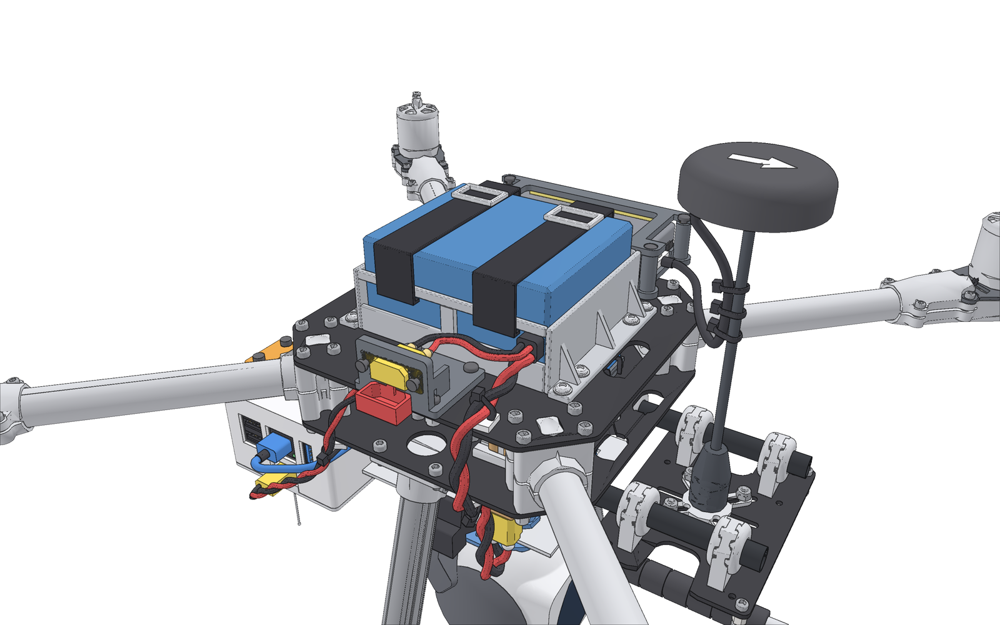 | 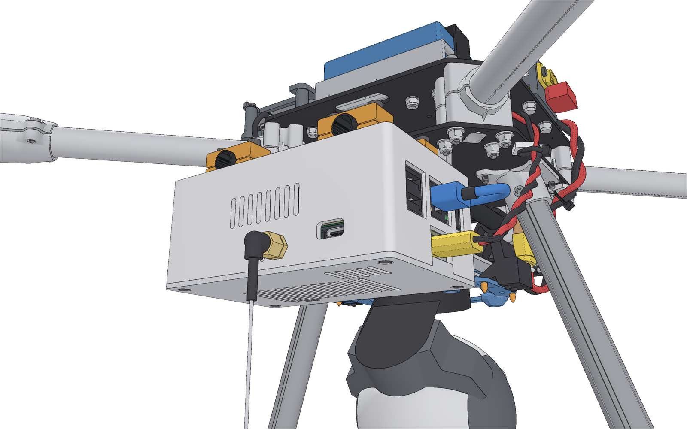 |

The drone model had no flight controller, no ESCs and no wiring; the green
board between the plates is the Holybro PM06 power board (35 × 35 mm).
`mechanical/wiring.py` adds them, in the drone's CAD frame:

- **Flight controller.** A Holybro Pixhawk 6C (84.8 × 44 × 12.4 mm, arrow
  forward) is clamped between two printed parts over the four free M3 holes on
  the top deck's right side (x = −33 / −6 mm, y = 143 / 168 mm). The tray stands
  on 4 mm bosses, screwed to the deck with four M3 × 12 screws, washers and
  nyloc nuts under the deck, and has four corner posts with M3 heat-set inserts.
  The lid, a 3 mm frame with a window over the board and open ends over the
  connectors, is held by four M3 × 8 screws in those inserts. The board sits
  between foam pads (below) and foam strips (under the lid), so it is held
  without being hard-mounted. The 6C's port positions are approximate.
- **GPS / compass.** The black puck on the mast is a GPS receiver with a
  compass (a Holybro M10-type module, 50 mm). It sits on the mast's tray, high
  above the frame, so the compass is away from the magnetic fields of the
  battery and motor currents. Its 10-wire cable leaves the module's underside,
  runs down the mast (three cable ties) and plugs into GPS1.
- **Power.** The battery leads go from a cable gland in the cradle's side rail.
  The discharge leads (2 × 12 AWG) run down the front edge, held by two
  adhesive tie bases, to an XT60 plug on the frame's XT60 under the bottom
  plate. The frame's XT60 is wired with 14 AWG leads to the PM06's battery pads.
  The charge leads (2 × 16 AWG) go to an XT60 panel socket in a printed bracket
  on the deck's four free left-side holes. The socket faces outwards, is held
  by two M2.5 screws with nuts, and its dust cap hangs open on its strap. The
  pack charges in place; its BMS is inside it.
- **ESCs and motors.** Four 20 A ESCs lie in pairs on two printed trays. The
  trays are screwed with countersunk screws into the bottom plate's free holes,
  with nuts underneath, and each ESC is held by two cable ties through slots in
  its tray. Each ESC's power leads and signal wire are soldered to its pads on
  the PM06, in the same order as on the ESC, so the leads do not cross. The
  phase wires run inside the carbon arm tubes to the motors.
- **Camera interface.** The D-80Pro's GCU (a separate box in the set; its
  size is assumed) sits on the rear face of the camera pylon, strapped through
  the pylon's two windows. Ethernet (tied under the rail holder), 17 V (XT30)
  and the control cable come from the FE-1 case. The gimbal lead goes round the
  end of the pylon to a connector on the damper head.
- **Data and power for the electronics.** TELEM2 runs from the carrier up the
  rear corner to the 6C. The 6C's power comes from the PM06's power connector,
  and its PWM outputs go to the PM06's PWM input. The two cables run together
  under the deck and up past its rear edge. The carrier's battery input is
  soldered to the PM06's battery pads.
- **Fasteners.** Every screw goes through its part and ends in a nut or an
  insert: the tray, bracket and battery-cradle screws in nyloc nuts under the
  deck, the ESC-tray screws in nuts under the bottom plate.
- **Checked** (`mechanical/out/wiring_report.json`, tested): every wire ends on
  its terminal (plug back, solder pad, solder cup, cable gland or motor) and
  leaves it in the terminal's direction. No cable touches the drone, the case,
  a new part or another cable, apart from the last millimetres at a connector or
  inside an arm tube. Every cable keeps out of the propeller discs, and no bend
  is tighter than the cable's own diameter. Every new part clears the drone,
  except where it rests on it.
- **Weight.** About 73 g of cable, 16 cable ties and 46 g of printed PETG parts.

| Print | Count | Notes |
|---|---|---|
| `mechanical/out/fc_tray.stl` | 1 | plate down; four M3 heat-set inserts in the posts |
| `mechanical/out/fc_lid.stl` | 1 | top face down |
| `mechanical/out/charge_bracket.stl` | 1 | base down |
| `mechanical/out/esc_tray_rear.stl`, `esc_tray_front.stl` | 1 each | base down |

The realistic game's operator view shows all of this too: the case, the flight
controller, the GPS module, the power parts, the cables and the camera in colour
(`tidewater-game/app/tools/flight_electronics_parts.py` writes them into
`detail/detail.json`), and it hides the Khadas Edge2, the old XIAO, the
Intel-camera bracket and the grey camera meshes. The drone camera the policy
sees still renders the scene it was trained on, and the physics are unchanged:
none of these parts has mass in the simulation.

## Simulation

The simulation is a library that knows nothing about a particular simulator. A
world hands it, every 40 ms, what really exists: the rendered camera frame, the
autopilot's estimate, the gimbal angles, a boat radio packet. It returns what
the companion computer would really see, and what the autopilot and the gimbal
really execute.

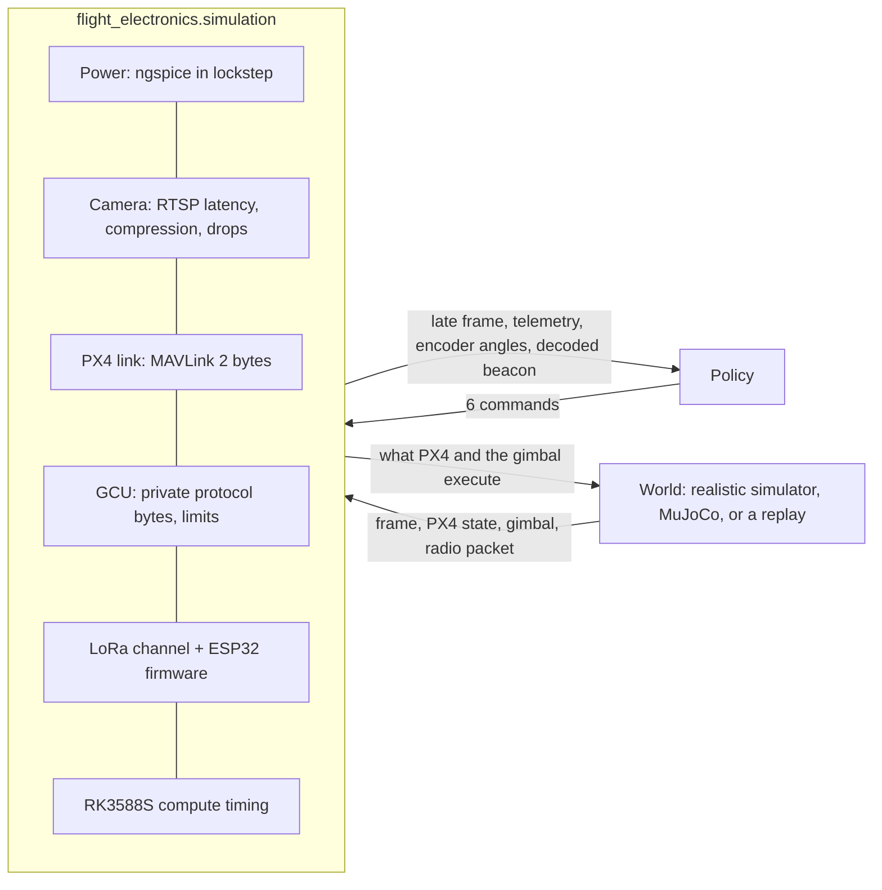

| Part | How it is simulated |
|---|---|
| Electrical | ngspice (the same SPICE engine KiCad uses). Cycle-by-cycle models of both converters; an averaged model of the whole aircraft supply solved in lockstep with the flight, every 40 ms. Brown-outs follow from the computed voltages. |
| ESP32 firmware | The firmware sources, compiled for the PC. A behavioral SX1262 answers the same SPI commands as the chip. |
| MAVLink, GCU | The companion code produces and parses the real bytes. The MAVLink encoder matches pymavlink byte for byte; the GCU code reproduces the example packets in the protocol document, CRC included. |
| Camera | 120 ms ± 15 ms network-camera latency (published figures for H.264 RTSP: 100–200 ms), JPEG-like compression, rare drops, 25 s reboot after a brown-out (assumption). |
| Compute | RK3588S timing model. The network runs on the NPU (from published RK3588 measurements of a network with the same amount of computation); the control code's times were measured here and scaled to one Cortex-A76 core. To be replaced by measurements on the board. |

### What the simulations show

| Question | Result |
|---|---|
| Is the 5 V supply clean? | 5.00 V, about 9 mV ripple; a 1.25 → 3.75 A step dips 136 mV (2.7 %). TI's targets: 25 mV and 4 %. |
| Does the camera supply hold? | 17.2 V from a 12 V (empty) pack, 22 mV ripple; a 1 → 2 A step dips 0.52 V (3 %). Soft start through the SS pin, 3.5 A peak switch current (limit 5.25 A). |
| Camera straight on the battery? | **It switches off after 13.5 minutes with 61 % charge left.** On the 17 V boost it stays on for the whole flight. |
| Battery-line spike, 8 V for 50 µs | The boost input reaches 27 V, below the TPS55340's 32 V rating. Rev A's TPS61288 (20 V absolute maximum) would have failed, which is why rev B changed the chip. |
| Does 25 Hz fit on the RK3588S? | Yes with the C++ marker kernel and the network on the NPU: about 18 ms while searching, 22 ms while tracking the pad, 47 ms for the first registration of the pad (one tick late). In pure Python the first registration takes about 275 ms. |

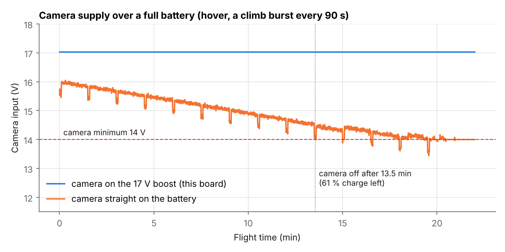

| 5 V buck | 17 V boost |
|---|---|
|  | 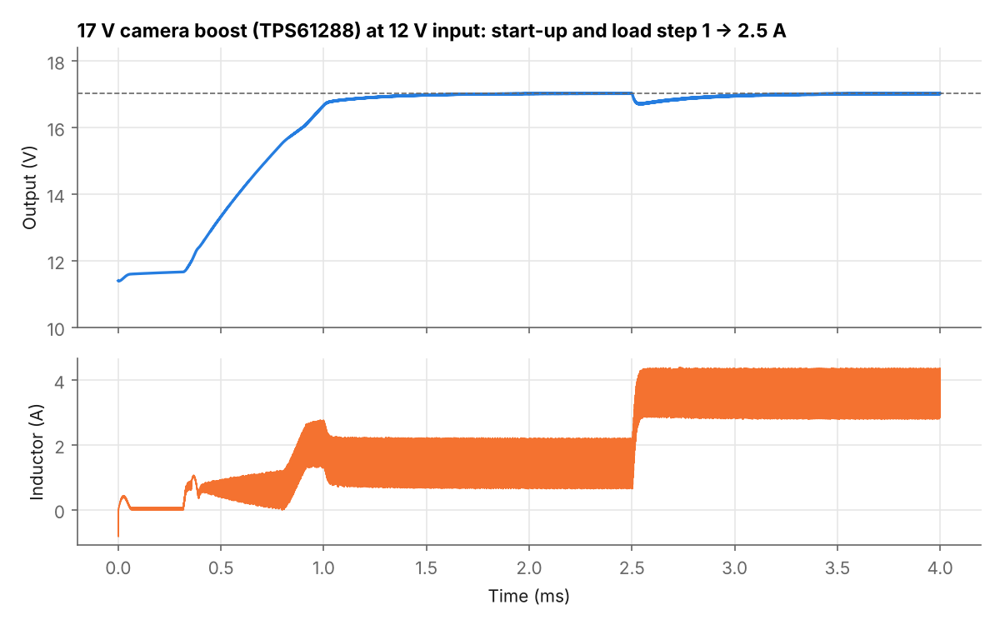 |

| Input spike | Decision latency |
|---|---|
|  | 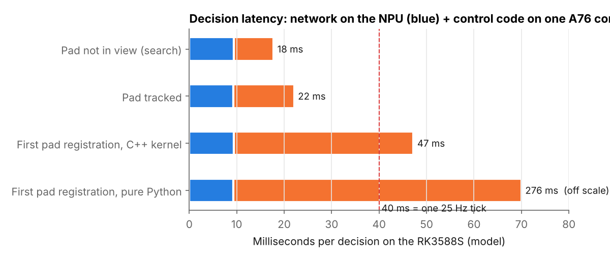 |

All numbers: [`media/simulation_results.json`](media/simulation_results.json).

## Benchmark with camera latency

The final policy, flown through the simulated hardware with **0.2 s camera
latency** (images arrive 240 ms old on average), over all 20 benchmark cases,
scored like the final benchmark run. These runs were made on Linux (the
benchmark adapter is pinned to Windows; `tidewater-game/hardware_runner/linux_compat.py`
replaces only the Windows-specific parts and records every deviation), so they
are working data, not benchmark evidence. Every case is in
[`media/benchmark_camera_latency.json`](media/benchmark_camera_latency.json).

| | Final run, fresh images | Through the hardware, 0.2 s latency |
|---|---|---|
| **Score** | **79.9** | **45.2** |
| Landed | 18 / 20 | 11 / 20 |
| Landing | 100 | 50 |
| Wind | 100 | 100 |
| Waves | 50 | 50 |
| Acquisition | 100 | 70 |
| Combined | 50 | 0 |
| Speed | 73.9 | 27.2 |

What the episode digests show:

- **Moving boat (1.5 m/s), both cases:** the pad stayed in the image the whole
  time, but the policy never locked on; the mission fell back after 69 s. At
  that speed the boat moves 0.36 m between a picture and its use.
- **Far visual search, 4 cases:** three ended without finding the pad (it was in
  the image about half the time at 45–100 m, never confirmed), one found it at
  82 s and ran out of time.
- **Near the deck:** in one far-radio case the drone came within 0.3 m of the pad
  and hovered there with the lock flickering until the time ran out.
- **Landings take longer:** in the 10 cases that landed both times, the median
  time grew from 58 s to 137 s, which costs most of the speed score.
- **Not repeatable at the edge:** an earlier single run of
  landing-landing-cruise-island-r0 with the same settings ended in a collision
  at 139.9 s; in this run it landed.

The policy was trained with fresh images. It needs latency in training (or a
latency-compensated controller) before this hardware can fly it.

## Run it

Python 3.10+ with numpy; ngspice as a shared library (`apt install libngspice0`,
or `ngspice.dll` from the ngspice Windows release); a C++ compiler for the
firmware (on Windows the prebuilt `firmware/prebuilt/fe_radio_bridge.dll` is
used when no compiler is found).

```powershell
python -m unittest flight_electronics.tests -v          # protocols, firmware, circuits, board
python -m flight_electronics.firmware.build_host        # firmware for the PC + its unit tests
python -m flight_electronics.tools.make_figures         # all simulations and figures
python3.12 -m flight_electronics.circuit.kicad.generate # schematic, PCB, ERC/DRC, renders (KiCad 9)
python -m flight_electronics.mechanical.frame            # case, lid, clamps, fit and clearance report (CadQuery)
python -m flight_electronics.mechanical.render           # case renders (trimesh, pyrender)
python -m flight_electronics.mechanical.wiring           # flight controller, power parts, cables, clearance report
python -m flight_electronics.mechanical.assembly         # models for the 3D viewer (mechanical/viewer/)
python tidewater-game/app/tools/flight_electronics_parts.py  # the same parts in the realistic game's operator view
```

Fly the realistic simulator through the simulated hardware (Windows, the same
setup as `benchmark.harness.tidewater_run`):

```powershell
python -B tidewater-game/hardware_runner/run.py run --name hw_try --case <case id>
python -B tidewater-game/hardware_runner/run.py run --name hw_late --case <case id> --state-of-charge 0.3 --variant camera_on_battery
python -B tidewater-game/hardware_runner/run.py smoke    # no MuJoCo/PX4: the policy and the byte paths only
```

Every episode gets a `hardware_summary.json` next to its `result.json`:
latency, late decisions, image age, battery and camera voltages, brown-outs,
radio packets. The adapter in `tidewater-game/hardware_runner/adapter.py` is the
only code that knows both sides.

The ESP32 firmware for the real board builds with ESP-IDF:
`cd firmware/esp32_radio_bridge/platform/esp32 && idf.py set-target esp32s3 build flash`.
It has not been compiled for the ESP32 in this repository's environment.

## Layout

| Path | Contents |
|---|---|
| `hardware/design.py` | Every value, its source or its assumption |
| `hardware/board.py` | Every part, footprint and connection of the carrier board |
| `circuit/kicad/` | Generated KiCad 9 project, BOM, ERC/DRC reports, the generator and router |
| `mechanical/` | Printed case, lid and rail clamps, Orange Pi 5 and connector models, flight controller and wiring, fit checks, renders, 3D viewer |
| `firmware/esp32_radio_bridge/` | Radio bridge firmware: SX1262 driver, protocol, application, ESP-IDF entry, PC build |
| `companion/` | Orange Pi 5 code: camera pipeline, MAVLink, GCU protocol, radio link, timing |
| `simulation/` | ngspice binding and circuits, device models, `hil.py` (the hardware simulation) |
| `tools/` | Figures and the system diagram |
| `tests/` | Unit tests |

## Open points

1. **Measure the battery line** on the drone (ESC braking spikes) and check that
   the 1 µH + 100 µF filter and the TPS55340's 32 V rating leave enough margin.
2. **Measure on the board**: network on the NPU (RKNN, FP16) and the control
   code with the C++ marker kernel, then replace the timing model's numbers.
3. **Check on the bench**: the GCU control-port pinout and logic level, the sign
   of the gimbal yaw, the camera's real latency on the sub-stream, the Orange Pi
   5 power draw, the payload-rail diameter.
4. **Camera latency.** The policy was trained and benchmarked with fresh frames.
   With 0.2 s of latency the score drops from 79.9 to 45.2 (see
   [benchmark](#benchmark-with-camera-latency)); train or tune with latency.
5. **Heat.** The heatsink is estimated, not measured: with air through the case
   in flight the RK3588S should stay near 65–70 °C at 8 W; standing still at
   8 W (natural convection, about 17 K/W) it would throttle. Measure the SoC
   temperature in the closed case.
6. **Check the wiring on the real parts.** The PM06's pad layout, the 6C's
   port positions and the GCU's size are approximations; adapt the cable
   lengths and the tray, lid and bracket to the parts before printing.

## Sources

- [Orange Pi 5 user manual](https://cdn.shopify.com/s/files/1/0252/6615/9704/files/OrangePi_5_RK3588S_User_Manual_v0.7.pdf): power, 26-pin header, weight
- [ALLXF D-80Pro](https://allxf.com/product/d-80pro-40x-4k-spherical-gimbal-camera/): specification sheet, user manual, GCU private protocol
- [TI TPS54560B](https://www.ti.com/lit/ds/symlink/tps54560b.pdf), [TI TPS55340](https://www.ti.com/lit/gpn/tps55340), [TI TPS61288](https://www.ti.com/lit/ds/symlink/tps61288.pdf) (rev A)
- [Seeed XIAO ESP32S3 + Wio-SX1262](https://wiki.seeedstudio.com/wio_sx1262_with_xiao_esp32s3_kit/), Semtech SX1261/2 data sheet
- [rk-bench RK3588 NPU measurements](https://github.com/anguoyang/rk-bench), [ncnn on small boards](https://github.com/nihui/ncnn-small-board)
- Drone, battery and motor data, CAD meshes: [`px4-mujoco-drone-simulation`](../px4-mujoco-drone-simulation/README.md)
- Orange Pi 5 board and connector positions: the supplied STEP model `mechanical/models/orange_pi_5.step` ("orange pi5 v3", exported from Autodesk; its author is not recorded in the file)
- 3D viewer: [three.js](https://threejs.org) r147
