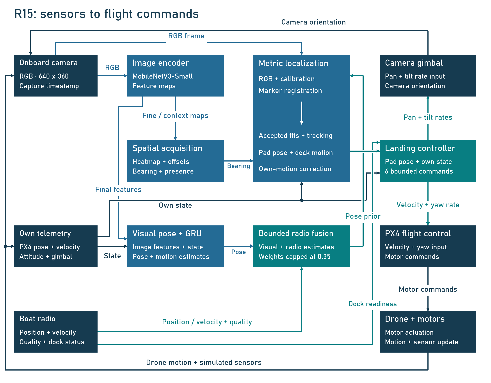
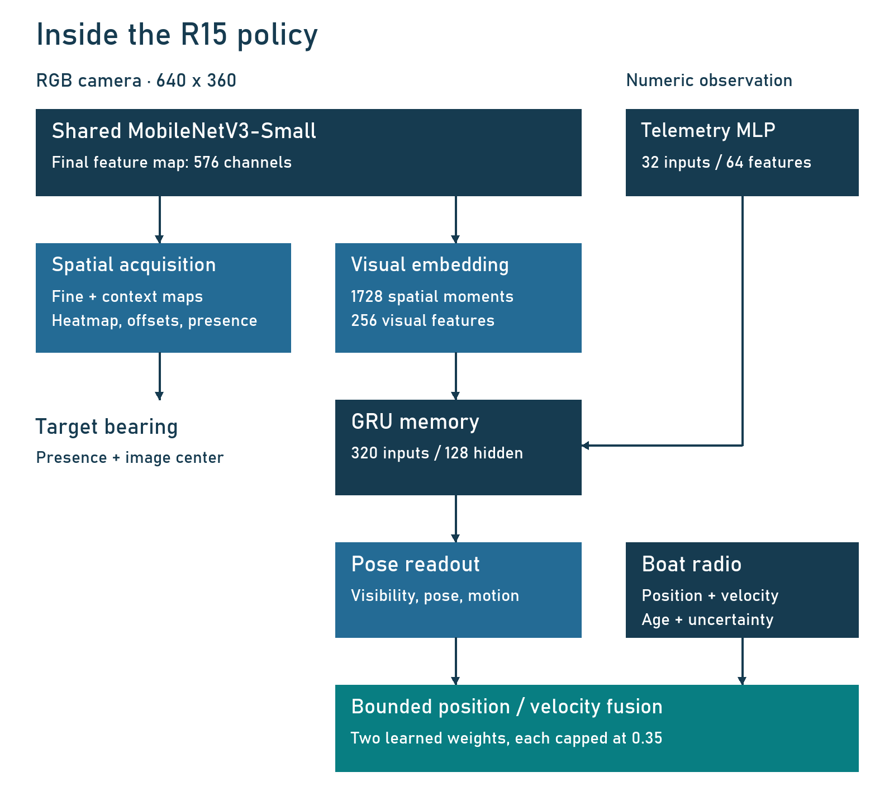

# Training a drone to land on a boat

**All model training happens in the MuJoCo training environment.** Tidewater is
used for visual-transfer experiments and gameplay; its scenes are not training
data. The frozen policy can also land under the unseen conditions shown in the
[five-map montage](../docs/media/drone-policy-landing.gif).

This package combines the drone and AERODOCK boat, generates demonstrations,
records observations and supplies the original learning pipeline.

## Training environment

| Part | Role |
|---|---|
| MuJoCo world | Original vehicle CAD, rotor thrust, buoyancy, drag and physical deck contact |
| PX4 | State estimation and low-level flight control |
| Variation | Five coastal map types, seeded routes, camera starts, wind, waves and appearance |
| Inputs | 640 × 360 onboard RGB, own telemetry and gimbal state; optional boat radio in the R15 lineage |
| Outputs | Forward/right/down velocity, yaw rate and camera pan/tilt rate at 25 Hz |
| Landing success | Stable, disarmed support on the target deck for at least two seconds |

Physics advances at 1 ms with 250 Hz sensor/actuator lockstep. The current search
dataset adds similar and dissimilar decoy boats, with no boat-radio input to
the learner.

## Learning from the teacher

The privileged teacher uses exact visible-instance pixels and simulator labels
to demonstrate search, inspection and landing. Visibility and resolution rules
limit which boats it can inspect and when identity labels become available.
Hidden boats do not enter its search controller. This extra information supplies
**training labels, never student inputs**.

Recordings synchronize RGB, sensors, commands and outcomes. The current curated
dataset has **60 episodes: 48 training, 6 validation and 6 test**. Validation
selects the checkpoint; test data is excluded from optimization. The learner
must then fly independently—teacher-assisted flights do not count as its successes.

Training is supervised. Early action imitation failed in flight, leading to
separate learned perception, geometric localization and explicit control.

## Policy architecture

R15 is the evaluated hybrid policy. Its neural components estimate the target
and its motion; calibrated geometry and explicit control turn those estimates
into a landing. The network does not directly predict motor commands.

| Signal | From | To |
|---|---|---|
| RGB frame | Onboard camera | Image encoder and metric marker registration |
| Image capture timing | Camera observation | Capture-motion compensation and metric tracking |
| Own pose, velocity, attitude and gimbal state | PX4 estimates and camera-joint feedback | Recurrent perception, geometric tracking and landing control |
| Boat position/velocity, packet age and uncertainty | Boat radio | Bounded position/velocity fusion |
| Reported dock readiness | Boat radio | Command safety checks |
| Target image bearing and learned pose | Spatial head and recurrent pose model | Metric registration and tracking |
| Pad pose and deck motion | Accepted geometric measurements and tracking | Landing controller |
| Three velocity commands and yaw rate | Landing controller and supervisor | PX4 flight control, then motor actuation |
| Pan and tilt rates | Landing controller and supervisor | Gimbal joints, changing the next camera view |

Motor actuation changes drone motion; simulated sensors update the PX4 estimate
and the camera renders the next view. The policy acts again on those observations.

### Neural architecture

### Shared image encoder

The 640 × 360 RGB frame is normalized with the model's stored image statistics
and passed through **MobileNetV3-Small**. Both perception branches reuse this
encoder. Intermediate feature maps preserve local target detail; the final
576-channel map supplies the recurrent pose branch.

### Spatial acquisition branch

Fine and context maps with 24 and 48 channels are projected to 24 channels each,
aligned in image space, and merged by two 3 × 3 convolutions. The resulting
48-channel map predicts a **target heatmap, sub-cell offsets and presence**.
Decoding yields an image center to guide acquisition and camera aiming before
a reliable metric pad pose is available.

### Recurrent pose branch

For each of the final 576 channels, the encoder retains mean activation and
activation-weighted horizontal/vertical position. These **1,728 values** preserve
coarse spatial information and are projected to **256 visual features**.

The numeric observation follows a **32-value contract**. A two-layer MLP maps it
to 64 features. Periodic angle representations replace the baseline's previous
action inputs. Boat-radio values and status are masked before this visual
memory path, so they cannot supply a hidden target coordinate to the GRU.

The 256 visual and 64 numeric features form a **320-value input to a GRU with
128 hidden units**. Its state carries information between camera frames.
Linear readouts produce a 15-value pose representation, including visibility,
relative position and velocity, heading, deck normal, image center and contact
probability. A separate six-value visual readout supplies the position/velocity
estimate used when no radio reference is available.

### Optional radio fusion

Boat radio enters **after** visual recurrence. A small MLP (**13 → 48 → 2**)
uses visual/radio disagreement, reported uncertainty and packet age to predict
separate position and velocity weights. Each weight is capped at **0.35**;
invalid or stale radio receives zero weight. The fused estimate moves toward
the radio estimate by that bounded amount. Raw radio coordinates do not bypass
this fusion stage to steer the controller.

### Geometry and flight control

The controller receives RGB, own telemetry and the learned estimates. Known
pad markings and camera calibration support metric marker fitting. Accepted
measurements, tracking and own-motion compensation estimate deck position and
motion. A confident neural detection alone cannot enable descent.

Explicit control handles search, alignment, motion matching, descent and
touchdown, with command bounds and recovery logic. It emits six values at 25 Hz:
three velocity commands, yaw rate, camera pan rate and camera tilt rate. PX4
handles flight control; the final two commands move the camera gimbal.

Implementation: [encoder and GRU](../artifacts/landing_hardening_20261018/candidate_r15/code/landing_training/policy.py),
[pose readout](../artifacts/landing_hardening_20261018/candidate_r15/code/landing_training/radio_robust_20261015/parent_model.py),
[spatial head](../artifacts/landing_hardening_20261018/candidate_r15/code/landing_training/radio_robust_20261015/spatial_acquisition.py),
[radio fusion](../artifacts/landing_hardening_20261018/candidate_r15/code/landing_training/radio_robust_20261015/model.py),
[runtime](../artifacts/landing_hardening_20261018/candidate_r15/code/landing_training/radio_robust_20261015/runtime.py).

### Search head under training

The next revision freezes the R15 model and trains a multi-boat search head on
its fine/context features. It initializes from the spatial acquisition weights,
then adds four-class evidence and two-class identity readouts to the shared
48-channel feature map. Heatmap, offsets and presence locate candidates;
evidence and identity decide which boat to inspect.

This head is feed-forward. The sensor-only search runtime maintains object
tracks and search state, then hands a confirmed target to the frozen R15
landing runtime. It learns acquisition rather than replacing PX4 or the landing
controller. [Search head implementation](../training_runs/search_revision_20261025/model.py).

The run uses AdamW, a 0.0003 learning rate, batch size 8 and 15 configured epochs.
It is separate from deployed R15 and the completed benchmark.
[Dataset and current trainer](../training_runs/search_revision_20261025/README.md).

## Matched benchmark

The 25 October comparison covers boat speed, crosswind, waves, distant search,
radio availability and static decoys. All **60 cases** were valid.

R15 completes more landings than the older policy. The older policy earns a
higher overall score because acquisition and completion speed also count.
No-radio acquisition remains the main weakness. Twenty cases per actor make
this a comparative screen; earlier suites use different conditions.

[Archived full results and failure analysis](../old/benchmark/archive/2026-11-10/reports/2026-10-25/RESULTS.md) ·
[Current benchmark design](../benchmark/README.md) · [Archived dashboard](../old/benchmark/archive/2026-11-10/ui/index.html)

## Development

| Stage | Change |
|---|---|
| 8–10 October | Coupled world, demonstrations and action-imitation baseline |
| 10–15 October | Learned pose, marker geometry and explicit control; unseen-condition tests and Tidewater transfer without retraining |
| 17–18 October | Vision-first radio fusion; R15 tracking, braking and recovery |
| 24–25 October | Matched benchmark and multi-boat search training |

## Find the implementation

| Area | Entry point |
|---|---|
| World | [`scene.py`](sim/scene.py), [`environment.py`](sim/environment.py), [`config.py`](sim/config.py), [`px4.py`](sim/px4.py) |
| Teacher | [`privileged_teacher.py`](teacher/privileged_teacher.py), [`smooth_landing.py`](teacher/smooth_landing.py), [`wave_teacher.py`](teacher/wave_teacher.py) |
| Data | [`recording.py`](data/recording.py), [`review.py`](data/review.py), [`collect.py`](data/collect.py) |
| Deployed R15 | [Frozen bundle and qualification](docs/CURRENT_POLICY.md) |
| Active search revision | [Run guide](../training_runs/search_revision_20261025/README.md) |
| Original setup | [Linux/WSL workflow](docs/history/ENVIRONMENT_REVIEW_BASELINE.md) |
| Detailed evidence | [Development report](docs/reports/LANDING_POLICY_DEVELOPMENT_REPORT_2026-10-17.md), [Tidewater tests](docs/reports/TIDEWATER_TEST_RESULTS_2026-10-18.md) |

The `training/policy.py` and `training/train.py` modules remain the original action-imitation baseline.
Use the run guide for current training and the [source map](docs/SOURCE_MAP.md)
to navigate modules. Frozen experiments remain in `artifacts/`.
