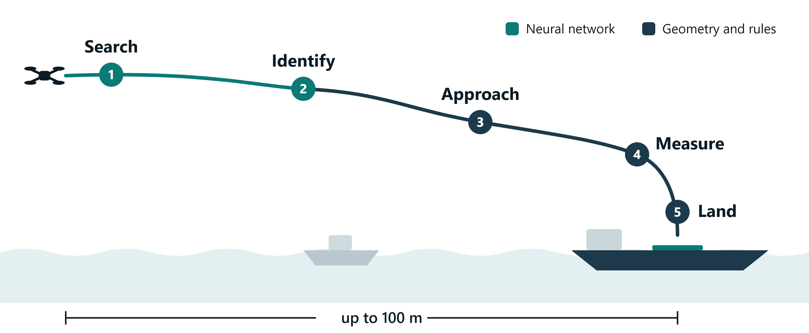
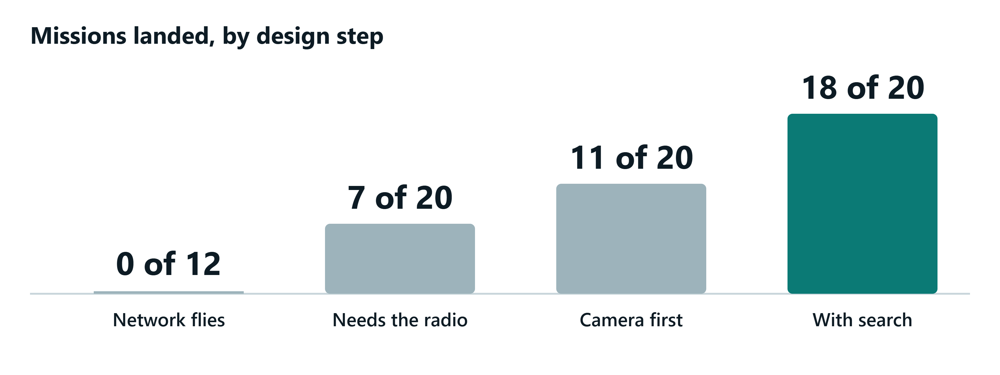

# Landing a drone on a moving boat

A quadrotor finds a moving boat up to 100 m away and lands on the small pad on
its deck, using its camera and its own sensors. The boat's radio can help it
find the boat but is not required. The task is hard because the boat keeps
moving, waves rock the deck, wind pushes the drone, and other boats can look
like the target. Everything is trained in simulation, with the real PX4
autopilot flying the drone. [Watch it land](../website/assets/hero.mp4).

## How it works

A neural network looks at the camera image, finds boats and decides which one
is the target. It does not steer. Once the drone is close, the known marking on
the pad gives its exact position, and a rule-based controller matches the
deck's motion and descends. PX4 turns those commands into motor output. The
radio, when there is one, only helps find the boat; the landing relies on the
camera.

This split is the key design decision. A first version, a network that learned
to fly directly by copying a teacher, landed in none of its 12 test flights,
because its small errors added up during the flight.

## How it was trained

A teacher that knows everything in the simulator flew the demonstrations and
supplied the labels. The learner only receives what a real drone would have:
the camera image and its own sensors. The search stage, which finds the target
among other boats, learned from 60 recorded flights. Since early November it
also checks what the camera sees against the radio position, when there is one,
and ignores sun glare.

Each bar is one version of the design. The first was tested on its own 12
flights, the others on the 20-mission benchmark below. The version that relied
on the radio landed none of the six missions flown without it. The camera-first
version (R15) landed only half of the search missions, and the search stage
fixed that.

## Results

All versions fly the same 20 missions: boat speeds up to 1.5 m/s, 4 m/s
crosswind, waves, searches from 100 m and decoy boats. A landing counts only
when the drone ends up disarmed and stable on the pad.

| Policy | Score | Landed |
|---|---:|---:|
| Teacher (sees simulator truth, upper reference) | 99.2 | 20 / 20 |
| Current search policy (8 Nov) | 87.8 | 18 / 20 |
| Camera-first policy R15, before the search stage | 57.5 | 11 / 20 |
| Radio-robust policy (15 Oct) | 54.9 | 7 / 20 |

The same network also flies in Tidewater, a browser game with graphics it never
saw in training. In a recorded session the drone started 122 m from a
stationary boat with the radio off and landed on the pad.

## What does not work yet

- The two missions that combine wind, waves, a 100 m search and decoys. With
  the updated control logic, one of them landed in a replay. In the other the
  drone got within 0.4 m of the deck, lost sight of the pad and ran out of time.
- Everything so far is simulation. There has been no real-world flight.

## Go deeper

| Question | Read |
|---|---|
| How do the network, the geometry and the search stage work? | [Architecture and training details](docs/ARCHITECTURE.md) |
| How are the 20 missions defined and scored? | [Benchmark](../benchmark/README.md) |
| How was the search stage trained? | [Search training run](../training_runs/search_revision_20261025/README.md) |
| Where is the code? | [Source map](docs/SOURCE_MAP.md) |
