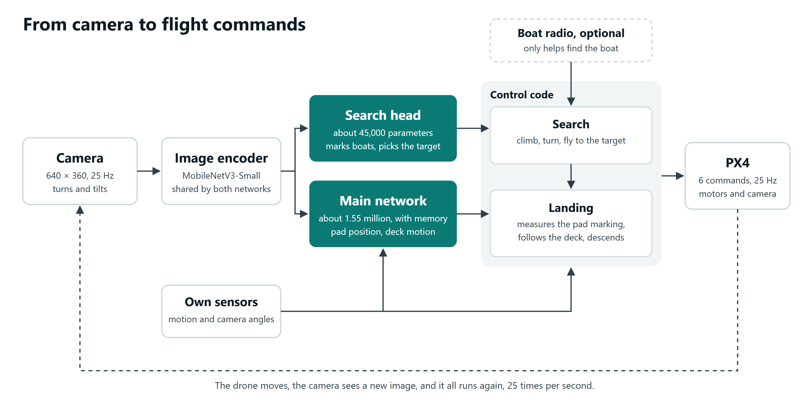
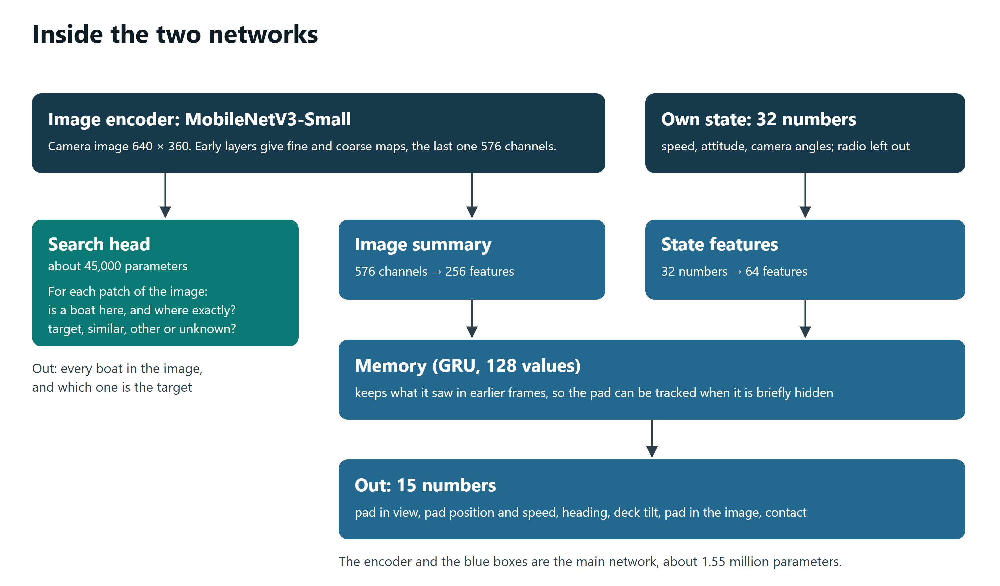

# Architecture and training details

Reference for readers who want the mechanics behind the [overview](../README.md):
the training world, the teacher, the two networks and the control code.

Names used in the overview: the **main network** is the R15 pose model (about
1.55 million parameters: image encoder and recurrent pose branch), frozen since
R15. The **search head** (about 45,000 parameters) sits on the same encoder.
The **pad finder** was R15's spatial acquisition branch; the final version does
not use it.

## Versions

There is one final version. Everything else is history kept as evidence.

| Version | Networks | Runs where | Benchmark |
|---|---|---|---|
| **Final** (`student.onnx`, 19 Nov) | Main network + search head | Realistic browser game; natively via `benchmark.harness.tidewater_run` | 79.9, 18 / 20 ([evidence](../../benchmark/evidence/final/summary.json)) |
| Search student `fresh-search-f62c10a2` (8 Nov) | Main network + pad finder + search head, radio blocked | Benchmark only | 72.8, 18 / 20 |
| R15 | Main network + pad finder | Benchmark only | 47.5, 11 / 20 |
| Radio-robust (15 Oct) | Earlier hybrid | Benchmark only | 44.4, 7 / 20 |

The final version's control code is
[`tidewater-game/app/public/policy/reference/`](../../tidewater-game/app/public/policy/reference/):
search and radio approach in [`student_radio.py`](../../tidewater-game/app/public/policy/reference/student_radio.py)
and [`student_runtime.py`](../../tidewater-game/app/public/policy/reference/student_runtime.py),
glare, near scan and near-deck rules in
[`tidewater_guidance.py`](../../tidewater-game/app/public/policy/reference/tidewater_guidance.py),
and the frozen R15 landing controller underneath. Where the pad finder used to
override the main network's pad point, the final version uses the main
network's own estimate.

## Training environment

| Part | Role |
|---|---|
| MuJoCo world | Original vehicle CAD, rotor thrust, buoyancy, drag and physical deck contact |
| PX4 | State estimation and low-level flight control |
| Variation | Five coastal map types, seeded routes, camera starts, wind, waves and appearance |
| Inputs | 640 × 360 onboard RGB, own telemetry and gimbal state; optional boat radio, used by the final version only to find the boat |
| Outputs | Forward/right/down velocity, yaw rate and camera pan/tilt rate at 25 Hz |
| Landing success | Stable, disarmed support on the target deck for at least two seconds |

Physics advances at 1 ms with 250 Hz sensor/actuator lockstep. The current search
dataset adds similar and dissimilar decoy boats, with no boat-radio input to
the learner.

## Learning from the teacher

The privileged teacher uses exact visible-instance pixels and simulator labels
to demonstrate search, inspection and landing. Visibility and resolution rules
limit which boats it can inspect and when identity labels become available.
Hidden boats do not enter its search controller. This extra information supplies
**training labels, never student inputs**.

Recordings synchronize RGB, sensors, commands and outcomes. The current curated
dataset has **60 episodes: 48 training, 6 validation and 6 test**. Validation
selects the checkpoint; test data is excluded from optimization. The learner
must then fly independently—teacher-assisted flights do not count as its successes.

Training is supervised. Early action imitation failed in flight, leading to
separate learned perception, geometric localization and explicit control.

## Policy architecture

The networks estimate where the boats, the pad and the deck are; calibrated
geometry and explicit control code turn those estimates into a landing. No
network predicts motor commands.

| Signal | From | To |
|---|---|---|
| RGB frame, 640 × 360 | Onboard camera | Image encoder, and pad-marking fit in the control code |
| Own pose, velocity, attitude and gimbal angles | PX4 estimate and camera joints | Main network and control code |
| Boats in the image: where, and target / similar / other / unknown | Search head | Search logic (which boat to fly to) |
| Pad visibility, position, velocity, heading, deck tilt, pad pixel | Main network | Landing logic |
| Boat position from the radio, if any | Boat radio | Search logic only: where to fly first |
| Pad pose and deck motion | Accepted marking fits and tracking | Landing controller |
| Three velocities and yaw rate | Control code | PX4, then the motors |
| Pan and tilt rates | Control code | Camera gimbal, which changes the next image |

The radio never reaches the networks or the landing: the main network's radio
inputs are fixed to "no radio", and the landing controller gets an observation
with the radio removed.

### Neural architecture

The whole browser model is one ONNX file, `student.onnx`; its forward pass is
written out in [`export-student-policy.py`](../../tidewater-game/app/tools/export-student-policy.py).

### Shared image encoder

The 640 × 360 RGB frame is normalized with the model's stored image statistics
and passed through **MobileNetV3-Small**. An early layer gives a fine map and a
middle layer a context map; the search head reads those. The final 576-channel
map feeds the main network's pose branch.

### Search head

About 45,000 parameters on the fine and context maps. Both are projected to 24
channels, aligned in image space and merged into a 48-channel map. Per cell of
a coarse grid it predicts a **heatmap, sub-cell offsets and presence** (is a
boat here, and where exactly), **four-class evidence** (target, similar,
different, not yet recognisable) and a **two-class identity**. It started from
the pad finder's weights and was trained with the main network frozen.

The head is feed-forward. The search logic keeps tracks of the boats over
time, decides which one to inspect, and hands a confirmed target to the
landing logic. [Search head implementation](../../training_runs/search_revision_20261025/model.py).
The run uses AdamW, a 0.0003 learning rate, batch size 8 and 15 configured
epochs. [Training-data generation](../../training_runs/training_data_generation/README.md).

### Main network: recurrent pose branch

For each of the final 576 channels, the encoder keeps the mean activation and
the activation-weighted horizontal and vertical position. These **1,728 values**
keep coarse spatial information and are projected to **256 visual features**.

The numeric observation follows a **32-value contract** (own velocity,
attitude, rates, gimbal angles, ages, previous action). A two-layer MLP maps it
to 64 features. The radio slots are always filled with the "no radio" values.

The 256 visual and 64 numeric features form a **320-value input to a GRU with
128 hidden units**, whose state carries information between frames. Linear
readouts give 15 values: visibility, relative position and velocity, heading,
deck normal, pad pixel and contact probability. Position and velocity come
from the visual readout, so they never depend on the radio.

### Geometry and flight control

The control code receives the RGB image, own telemetry and the network
estimates. Known pad markings and camera calibration give metric marker fits.
Accepted fits, tracking and own-motion compensation estimate deck position and
motion. A confident network estimate alone cannot start the descent.

Explicit control handles search, alignment, motion matching, descent and
touchdown, with command bounds and recovery logic. It emits six values at 25 Hz:
three velocity commands, yaw rate, camera pan rate and camera tilt rate. PX4
flies the drone; the last two commands move the camera gimbal. The code is in
[`tidewater-game/app/public/policy/reference/`](../../tidewater-game/app/public/policy/reference/).

## History: what R15 had in addition

R15 and the 8 November search student also ran two parts that the final version
does not use:

- **Pad finder** (spatial acquisition branch, about 45,000 parameters): the same
  fine/context design as the search head, predicting one pad point and its
  presence. While no fresh marker fit existed, its point replaced the main
  network's pad pixel and steered the camera.
- **Bounded radio fusion**: a small MLP (13 → 48 → 2) after the GRU that moved
  the position and velocity estimate towards the radio by at most 0.35.

Their figures are kept as [R15 system](../../docs/media/policy-architecture-detailed.png)
and [R15 networks](../../docs/media/policy-neural-architecture.png).
