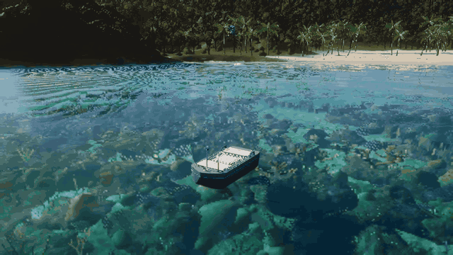

# Tidewater

[](../docs/media/tidewater-landing-1080p.mp4)

Tidewater puts the drone and the boat into a realistic coastal world as a small
playable game. Fly either vehicle, or hand the drone to the trained policy.

**The policy is trained only in MuJoCo, never on Tidewater scenes.** Tidewater
tests whether it still lands when everything it sees looks different.

## Run locally

Use Node.js 22+ and a WebGPU-capable Chrome or Edge. From the repository root:

```sh
cd tidewater-game/app
npm ci
npm run build
npm start
```

Open **http://127.0.0.1:5189/** manually. On Windows,
[`Start-TidewaterGame.ps1`](Start-TidewaterGame.ps1) builds a missing package and
serves it; `-Dev` starts Vite. Rebuild after source changes. First load prepares
the collision world and shaders. Wait for **Offline files ready** for offline play.

## Play with the policy

1. Press **B** for the boat. Open the lids (**K**), then raise the platform (**J**).
   The boat can keep driving.
2. Press **B** for the drone and take off (**T**).
3. Press **L**. The policy takes the drone, finds the boat and lands. **L** again
   returns manual control.

| Key | Action |
|---|---|
| B | Switch between drone and boat |
| Drone: WASD, R/F, Q/E | Fly, climb/descend, yaw |
| Mouse or arrows | Aim the camera |
| T / L | Take off or land / hand over to the policy |
| Boat: W/S, A/D, P | Throttle, steering, automatic route |
| K / J | Lids / landing platform |
| U / V / G | Boat camera / free camera / screenshot |
| X / C | Boat radio off and on / reconnect |
| Home | Reset |

The boat stays controllable during a landing. Lower the platform before closing
the lids.

## What the game adds

WebGPU renders the coastal world and the onboard camera. Browser WASM workers
run MuJoCo vehicle physics and PX4; the policy runs locally with ONNX/WebGPU
inference and a Python controller. No server-side flight process is needed.

The policy must work from the images Tidewater actually renders. It is not a
different background placed behind a prerecorded landing. This makes the game
an interactive visual-transfer experiment as well as a way to explore the system.

Finding a distant or obscured target remains difficult.
[Integration results](benchmarks/flight-parity/landing-hardening-20261018.md) and
[stress tests](../landing_training/docs/reports/TIDEWATER_TEST_RESULTS_2026-10-18.md)
document successful flights and failures.

## Explore the implementation

| Read | Purpose |
|---|---|
| [Training and architecture](../landing_training/README.md) | MuJoCo world, teacher and learned policy |
| [Runtime reference](docs/RUNTIME_REFERENCE.md) | Hosting headers, offline caching and policy export |
| [WASM integration](wasm/README.md) | PX4/MuJoCo builds and parity tests |
| [Recording details](../docs/media/README.md) | Demo source, model version and 1080p export |

The game extends [dgreenheck/tidewater](https://github.com/dgreenheck/tidewater).
[Asset credits](app/CREDITS.md) and [runtime licenses](app/public/licenses/)
are retained. Custom hosts must support the COOP/COEP headers configured by the
included server.
