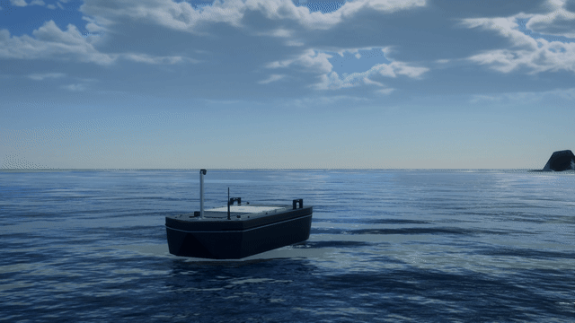

# Realistic simulator

[](../docs/media/tidewater-boat-1080p.mp4)

This game puts the drone and the boat into a realistic coastal world that runs
in the browser. Fly either vehicle yourself, or hand the drone over and let it
find the boat and land.

The world comes from [Tidewater](https://github.com/dgreenheck/tidewater) by
dgreenheck (DRG Software Solutions, MIT licence), an open-source island fishing
game with its own
WebGPU ocean, sky and reef. We kept its world and rendering, and added the
drone, the AERODOCK boat, MuJoCo and PX4 running in the browser, the boat
radio and the landing policy.

The networks that do this were trained only in MuJoCo and never saw an image
from this world, so every landing here is a test of how well they carry over.
The drone flies the final version of the policy, the same build that was
scored on the [benchmark](../benchmark/README.md).

## Run locally

Use Node.js 22+ and a WebGPU-capable Chrome or Edge. From the repository root:

```sh
cd tidewater-game/app
npm ci
npm run build
npm start
```

Open **http://127.0.0.1:5189/** manually. On Windows,
[`Start-TidewaterGame.ps1`](Start-TidewaterGame.ps1) builds a missing package and
serves it; `-Dev` starts Vite. Rebuild after source changes. First load prepares
the collision world and shaders. Wait for **Offline files ready** for offline play.

## Play with the policy

1. Press **B** for the boat. Open the lids (**K**), then raise the platform (**J**).
   The boat can keep driving.
2. Press **B** for the drone and take off (**T**).
3. Press **L**. The policy takes the drone, finds the boat and lands. **L** again
   returns manual control.

With the boat's radio on, the drone flies straight to the boat and then
confirms it with the camera. Press **X** to switch the radio off; the drone then
climbs and turns on the spot until its camera finds the boat.

| Key | Action |
|---|---|
| B | Switch between drone and boat |
| Drone: WASD, R/F, Q/E | Fly, climb/descend, yaw |
| Mouse or arrows | Aim the camera |
| T / L | Take off or land / hand over to the policy |
| Boat: W/S, A/D, P | Throttle, steering, automatic route |
| K / J | Lids / landing platform |
| U / V / G | Boat camera / free camera / screenshot |
| X / C | Boat radio off and on / reconnect |
| Home | Reset |

The boat stays controllable during a landing. Lower the platform before closing
the lids.

## What it tests

WebGPU draws the coast and the drone's camera image. MuJoCo and PX4 run in the
browser as WebAssembly, the main network and the search head run locally
through ONNX Runtime, and the control code runs in Python inside the page. No
server takes part in a flight.

The networks only ever see the images this world renders, not a new background
pasted behind a recorded flight. So the game checks whether what they learned
in MuJoCo still works in a world that looks different. Here the sun also makes
glare on the water; the search code recognises glare spots and ignores them. In recorded sessions
with the radio off, the drone found the boat and landed on the pad from 122 m
away, and from 15 m with the boat behind it. A few recordings are not a success
rate, though.

Tests from October, made with the earlier R15 policy:
[integration results](benchmarks/flight-parity/landing-hardening-20261018.md)
and [stress tests](../landing_training/docs/reports/TIDEWATER_TEST_RESULTS_2026-10-18.md)
(in German).

## Explore the implementation

| Read | Purpose |
|---|---|
| [How the landing works](../landing_training/README.md) | The two networks, the search and the landing, and how they were trained |
| [Runtime reference](docs/RUNTIME_REFERENCE.md) | Hosting headers, offline caching and policy export |
| [WASM integration](wasm/README.md) | PX4/MuJoCo builds and parity tests |
| [Recording details](../docs/media/README.md) | Demo source, model version and 1080p export |

[Asset credits](app/CREDITS.md) and [runtime licenses](app/public/licenses/)
are retained. Custom hosts must support the COOP/COEP headers configured by the
included server.
