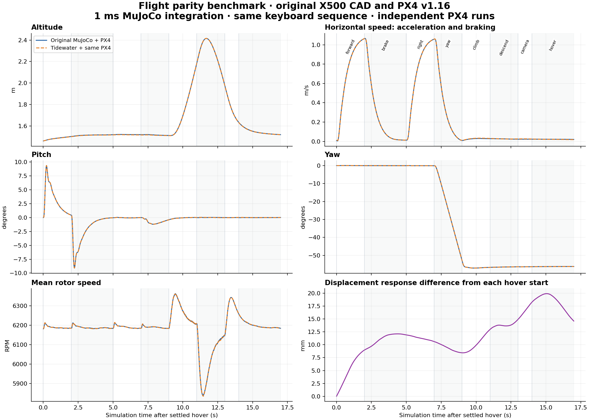

# X500 flight parity benchmark

Reference model: **X500_V2_PX4_MuJoCo** (the local file names it X500 V2).

## Method

- Original `Simulation.physics` and `Simulation.setpoints` are executed directly from the existing simulator source.
- Reference rendering meshes/textures are omitted; collision shapes, inertias, joints, sensors and actuators are retained.
- Tidewater uses its own combined boat/drone model; the benchmark adds the same launch floor and places the boat away from the flight path.
- Body mass/inertia, joint axes/ranges/damping/armature, collision parameters, rotor inertia and solver settings are checked before running.
- Motor replay exercises throttle steps, differential thrust, camera motion and seeded gusts at 1 kHz.
- Independent PX4 processes exercise takeoff/hover, forward acceleration, braking, strafe, yaw, climb, descent and camera control.
- Firmware binary SHA-256 and original parameter/source hashes are recorded in `report.json`.
- A repeated original PX4 run measures reference repeatability. Runs are aligned in time at settled hover; displacement is measured from each actual hover start. Absolute-world errors and initial hover offsets are also retained in the JSON report.

## Results

| Metric | Tidewater versus original | Original repeat |
|---|---:|---:|
| Maximum position difference (mm) | 19.9129 | 10.6916 |
| Maximum velocity difference (m/s) | 0.00592238 | 0.011055 |
| Maximum attitude difference (degrees) | 0.0636655 | 0.623061 |
| Maximum camera difference (degrees) | 0.000399996 | 0.0011696 |
| Maximum rotor difference (RPM) | 11.8718 | 116.265 |

## Handling measurements

| Metric | Original | Tidewater |
|---|---:|---:|
| Arming delay (s) | 2.044 | 2.044 |
| Takeoff to settled hover (s) | 13.1 | 13.172 |
| Time to 0.9 m/s (s) | 1.108 | 1.112 |
| Forward speed after 2 s (m/s) | 1.06451 | 1.06438 |
| Braking to below 0.1 m/s (s) | 1.404 | 1.404 |
| Braking distance (m) | 0.684587 | 0.684909 |
| Climb over 2 s (m) | 0.674229 | 0.67508 |
| Descent over 2 s (m) | -0.206683 | -0.20649 |

Times in this table are simulation seconds. Live game pacing is recorded separately in [live-game-verification.json](live-game-verification.json).



Calm motor replay agrees to floating-point precision. Gust replay has its own measured error in the report; no percentage score hides individual metrics.

The flight laws, physics parameters and firmware are shared. Independent PX4 startup/estimator timing can produce different trajectories, so these runs are not claimed to be bitwise identical.
This benchmark compares simulator behavior, not real-world X500 calibration. It does not measure browser FPS or radio hardware.

## Reproduce

```bash
OPENBLAS_NUM_THREADS=1 MUJOCO_GL=disable NUMBA_CACHE_DIR=simulation/runtime/native-cache-linux \
  ~/.cache/tidewater-game/python/bin/python simulation/tests/benchmark_flight.py
```

Run from `tidewater-game` in WSL after preparing the collision model. Then run `simulation/tests/render_flight_benchmark.py` with Python/Matplotlib.
The NPZ files preserve full-precision samples; CSV files are provided for analysis. The PDF figure is suitable for export.
